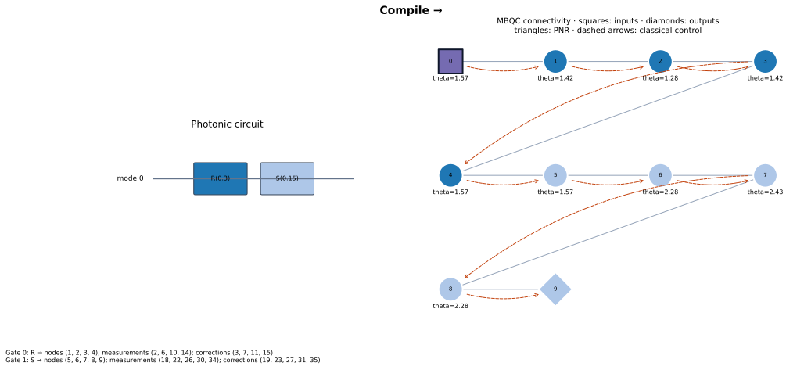

# PhotoGraphiQ

**Continuous-variable photonic measurement-based quantum computing in Python.**

[](https://github.com/chinmoybiswasdeep/PhotoGraphiQ/actions/workflows/ci.yml)
[](pyproject.toml)
[](LICENSE)
[](https://github.com/chinmoybiswasdeep/PhotoGraphiQ/actions/workflows/docs.yml)
[](https://docs.astral.sh/ruff/)
[](https://github.com/chinmoybiswasdeep/PhotoGraphiQ/stargazers)
[](https://github.com/chinmoybiswasdeep/PhotoGraphiQ/issues)
[](https://github.com/chinmoybiswasdeep/PhotoGraphiQ/pulls)



PhotoGraphiQ connects optical circuits to labelled cluster resources, adaptive
measurements and classical corrections. Build a reusable experiment, simulate its
conditional outputs, and inspect finite-squeezing noise or Fock-cutoff convergence.

See the [v0.3 release report](docs/development/v0.3-release-report.md) for local
validation results, the changed-file inventory and experimental feature limits.

## Why PhotoGraphiQ?

PhotoGraphiQ provides the CV-MBQC layer: weighted graphs, causal patterns,
compilation, feed-forward, resource injection, diagnostics and independent
validation. It runs on its own NumPy and C++20 (Eigen, OpenMP) Gaussian, Fock and
mixed-Fock engines. Piquasso is an optional reference simulator, not a runtime
requirement.

This repository ships two import packages from one distribution:

| Package | Owns | Depends on |
| --- | --- | --- |
| `photographiq` | CV states, graphs, patterns, compilation, homodyne measurement, feed-forward, finite squeezing, NumPy and native C++ Gaussian/Fock/mixed-Fock backends, boson sampling and GBS, flows and measurement calculus, GKP encoding and decoding, numerical validation | NumPy, SciPy, NetworkX; compiled `photographiq._native` extension |
| `photographiqml` | Measurement-based learning: MuTA and triangle ansätze, parameter stores, training, kernels, classifiers/regressors, expressivity diagnostics, logical-to-physical GKP lowering | `photographiq` |

The core never imports `photographiqml` and needs no ML framework. See the
[integration report](docs/development/merged-integration-report.md) for how the
formerly separate PhotoGraphiQML repository was merged.

## Install from source

Python 3.11–3.14. Until a package release is verified, use the source checkout:

```sh
git clone https://github.com/chinmoybiswasdeep/PhotoGraphiQ.git
cd PhotoGraphiQ
python -m pip install -e ".[dev]"     # editable; installs photographiq and photographiqml
python -c "import photographiq, photographiqml"
```

Runtime dependencies are NumPy, SciPy and NetworkX. Installing from source compiles
the native engines with a C++20 compiler and CMake; see
[building the native engines](docs/development/native-build.md). Without the
extension, the NumPy backends and all pure-Python tools still work. Optional extras:

| Extra | Adds | Used by |
| --- | --- | --- |
| `piquasso` | Piquasso 8.0.1 | `piquasso*` reference backends; default physical PhotoGraphiQML backend |
| `precision` | mpmath | multiprecision threshold (torontonian) probabilities |
| `gpu-cuda12`, `gpu-cuda13` | CuPy | batched Gaussian kernels on an NVIDIA GPU ([GPU guide](docs/gpu.md)) |
| `visualization` | Matplotlib | drawing graphs, patterns, MuTA |
| `validation` | Graphix 0.4 | MBQC structure cross-checks |
| `autodiff` | JAX | differentiable fixed-outcome Fock execution |
| `ml-validation` | MentPy 0.1.0a15 | independent logical MuTA reference tests |
| `ml-experiments` | Matplotlib, scikit-learn | classical baselines in the PhotoGraphiQML manuscript suite |
| `docs` | MkDocs toolchain | building this website |
| `dev` | pytest, ruff, mypy, build, Matplotlib, Graphix, nbformat | development and the full test suite |

## Five-minute start

```python
import photographiq as pg

graph = pg.CVGraph.line(2, squeezing=1.0, inputs=(0,))
pattern = pg.Pattern(graph).measure(0, pg.Homodyne.p())
pattern.displace(1, q=-pg.Outcome(0))
result = pg.simulate(pattern, inputs={0: pg.GaussianInput.coherent(0.3+0.2j)}, seed=7)
print(result.outcomes)              # sampled readings, not amplitudes
print(result.state.quadrature(1))   # q mean and variance
pattern.draw(output="cluster.svg")
```

This is one Fourier wire step with finite resource noise. For identity transport,
use `pg.protocols.identity()`. [Read the quickstart](docs/getting-started/quickstart.md).

## Circuit → MBQC

```python
circuit = pg.Circuit(1).rotate(0, 0.3).squeeze(0, 0.15)
compiled, trace = circuit.compile(squeezing=0.8, return_trace=True)
pg.visualize_compilation(circuit, compiled, trace=trace, output="compilation.svg")
channel = pg.gaussian_channel(compiled)
print(channel.matrix, channel.noise)  # ideal linear map and physical added noise
```

Matching colors link source gates to generated resources. The trace identifies
measurements and corrections. PNG, SVG and PDF export use optional Matplotlib.

## Non-Gaussian experiments

```python
pattern = pg.non_gaussian.photon_subtraction(theta=0.2)
result = pg.simulate(pattern, inputs={"in": pg.FockInput.number(2)},
                     backend="native-fock", cutoff=8,
                     measurement_outcomes={"count": 1})
print(result.state.photon_number("in"))  # one photon, conditioned on the herald
```

v0.3 also introduces experimental density-matrix evolution, Gaussian-plus-cubic
compilation with quartic/Kerr synthesis, finite-energy GKP resources and optional
JAX differentiation. These paths have explicit numerical and feature limits.

The [scientific hardening report](docs/development/v0.3-scientific-hardening.md)
records independent validation, repaired defects, convergence measurements and
remote release gates. Codecov rejected tokenless upload; a `CODECOV_TOKEN`
repository secret and a verified main-branch upload are required before restoring
the coverage badge. Measured coverage remains available in CI artifacts.

## Backends, sampling and MBQC structure

```python
from photographiq import sampling

U = sampling.haar_unitary(4, rng=1)
print(sampling.output_probability(U, [1, 1, 0, 0], [0, 1, 1, 0]))   # |Perm|^2
state = sampling.squeezed_interferometer_state([0.5, 0.5, 0, 0], U, transmissivity=0.9)
print(sampling.threshold_probability(state, [1, 0, 1, 0]))           # torontonian
```

- **Backends.** `gaussian` (default, NumPy), `native-gaussian`, `native-fock` and
  `native-mixed-fock` (C++20), optional `piquasso*` references. Use
  `pg.available_backends()`, `pg.describe_backend(name)` and
  `pg.select_backend(pattern)`; see [select a backend](docs/user-guide/backends.md).
- **Boson sampling and GBS** (`photographiq.sampling`): permanents, hafnians, loop
  hafnians, torontonians, exact distributions and samplers. Threshold probabilities
  report an error estimate and accept `precision=` for multiprecision.
- **Flows and calculus** (`photographiq.flows`, `photographiq.calculus`): causal
  flow, gflow, Pauli flow and CV determinism with a `FlowAnalysisResult`; qubit
  and CV measurement calculus, local Cliffords and a ZX subset.
- **Interactive views** (`photographiq.interactive`): graph editor, flow and
  correction overlays, execution traces and scientific plots.
- **GPU** (`photographiq.gpu`): batched Gaussian kernels on CuPy that report the
  device they ran on and never fall back to the CPU silently.

[Complete functionality reference](docs/COMPLETE_FUNCTIONALITY.md) ·
[benchmarks](benchmarks/README.md) · [architecture figures](docs/architecture/README.md)

## Measurement-based learning with PhotoGraphiQML

`photographiqml` builds trainable measurement patterns on top of the core API.
Logical MuTA is an ideal qubit-level model (independently checked against MentPy
when the `ml-validation` extra is installed):

```python
import numpy as np
import photographiqml as pqml

model = pqml.MuTA(2, 1, one_column=True)               # one paper (2,0) layer
print(model.run([1, 0, 0, 0], {"alpha.w1.c1": np.pi / 2}).probabilities)
# [0.5, 0, 0, 0.5] up to roundoff

clf = pqml.MuTAClassifier(pqml.MuTA(1), trainer=pqml.Trainer(epochs=60), seed=0)
clf.fit([[0.0], [0.1], [3.0], [3.14]], [1, 1, 0, 0])
print(clf.predict([[0.05], [3.1]]))                     # [1, 0]
```

Physical execution lowers the restricted signed-X family (intermediate angles 0 or
pi modulo 2pi) onto finite-energy GKP resources. It defaults to the
`piquasso-fock` backend (install the `piquasso` extra) so recorded results stay
reproducible; `GKPPhysicalConfig(backend="native-fock")` uses the native engine,
which is cross-validated against it. It returns raw analog records, decoded
probabilities and the ideal logical target separately:

```python
cfg = pqml.GKPPhysicalConfig(cutoff=40, peak_width=0.9, envelope=0.9, peaks=4,
                             grid_points=1025)
result = pqml.PhysicalMuTA(physical_config=cfg).run([1, 0], mode="physical-shots",
                                                     shots=4, seed=14)
print(pqml.compare_logical_physical(result)["total_variation_distance"])
```

This broad, unconverged resource gives a total-variation distance of about 0.26
from the logical target; it illustrates execution, not accuracy. Arbitrary-angle
physical MuTA is **unsupported** and is rejected before any Fock allocation. See
the [PhotoGraphiQML documentation](docs/ml/index.md) and the
[core/ML contract](docs/development/photographiqml-contract.md).

## Manuscript experiments

Two independent, suite-qualified experiment suites are kept side by side:

| Suite | Directory | IDs | Scope |
| --- | --- | --- | --- |
| PhotoGraphiQ core | [`paper_experiments/`](paper_experiments/README.md) | PGQ-R1 to PGQ-R42 | CV-MBQC transport, compilation, feed-forward, non-Gaussian, GKP, Piquasso/Graphix validation, convergence, performance |
| PhotoGraphiQML | [`paper_experiments_ml/`](paper_experiments_ml/README.md) | PGML-R1 to PGML-R59 | logical MuTA, MentPy validation, gradients/training, kernels, expressivity, GKP lowering, physical statistics |

Both suites number experiments from R1, so always cite the suite prefix. Recorded
results are kept byte for byte as produced in their source repositories.

```sh
python paper_experiments/run_all_safe.py       # fast PhotoGraphiQ subset
python paper_experiments_ml/run_all_safe.py    # fast PhotoGraphiQML subset
python paper_experiments_ml/run_all_full.py    # complete ML suite; needs the ml-validation and ml-experiments extras
```

## Documentation and examples

- [Documentation home](docs/index.md) and [installation](docs/getting-started/installation.md)
- [24 executable tutorials](docs/tutorials/index.md), [10 demo projects](examples/projects/README.md), and [notebooks](notebooks)
- [Inputs](docs/user-guide/inputs.md), [outputs](docs/user-guide/outputs.md), and [API reference](docs/api/index.md)
- [Feature matrix](docs/validation/feature-matrix.md), [performance](docs/performance.md), and [roadmap](ROADMAP.md)

The Pages workflow targets `https://chinmoybiswasdeep.github.io/PhotoGraphiQ/`.
Until deployment is verified, use the repository documentation or run
`python -m mkdocs serve` with the docs extra. Badge status comes from the named
services; coverage may remain unavailable until Codecov is activated.

## Validation and research status

Conventions: `[q,p]=2i`, interleaved quadratures, vacuum statistical covariance I,
radians, and positive resource squeezing means momentum squeezed. A coherent
amplitude alpha has means `(2 Re(alpha), 2 Im(alpha))`.

Analytical CV theory, independent NumPy/SciPy references and raw Piquasso programs
check numerical physics. Graphix checks **MBQC structure**, never CV amplitudes or
quadrature distributions. See the [validation policy](docs/validation/index.md)
and preserved [v0.2 hardening evidence](docs/release-hardening-report.md).

Finite squeezing is physical. Fock truncation, synthesis steps, GKP grids and
gradient estimators each require their own convergence checks. A selected
homodyne outcome reports a density, not an event probability. A universal target
gate set does not imply exact finite-resource gates or arbitrary-unitary synthesis.

## Citation and contribution

Use [CITATION.cff](CITATION.cff) and include the version/commit used. Cite relevant
upstream software and protocols listed in [references](docs/references.md).
No DOI or journal acceptance is claimed. The [paper source](paper/PhotoGraphiQ.tex)
and historical validation artifacts remain available for reproducibility.

Contributions are welcome: read [CONTRIBUTING.md](CONTRIBUTING.md), the
[code of conduct](CODE_OF_CONDUCT.md), and [security policy](SECURITY.md).
Original software is [MIT licensed](LICENSE); bundled third-party research
material retains its original licensing.

## Encoded GKP interface (0.3.1)

Physical GKP X/Z readout, finite Kraus instruments, structured decoding and logical
Pauli frames are available through the public API. Finite codewords remain
nonorthogonal. Physical Y, magic-angle and arbitrary logical XY measurements are
unsupported; full physical MuTA remains blocked. See the
[downstream contract](docs/development/photographiqml-contract.md),
[validation report](docs/development/gkp-logical-interface-hardening.md), and
[encoded tutorials](docs/tutorials/gkp-logical-index.md).
