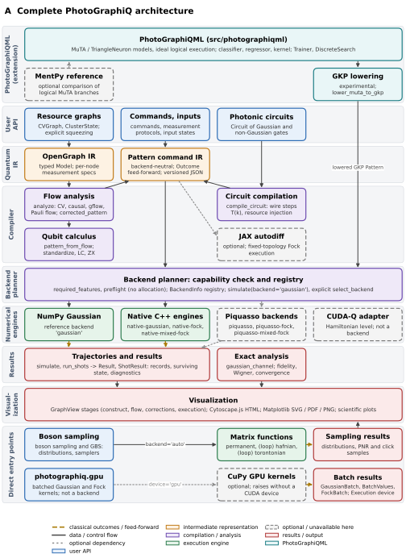
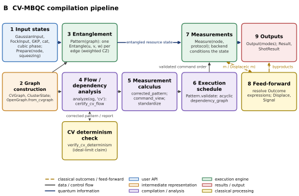
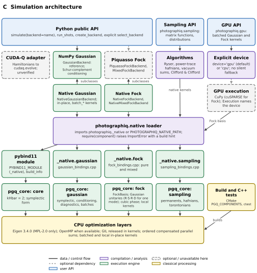
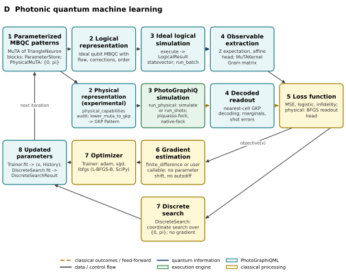
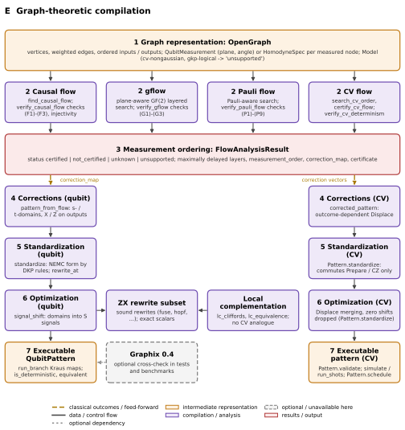
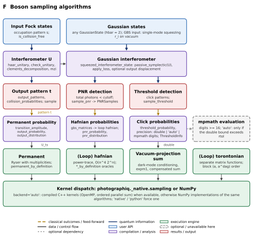
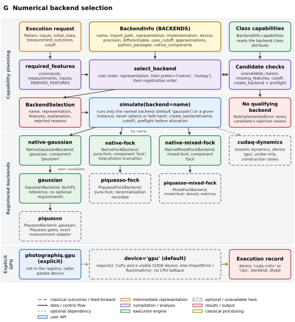
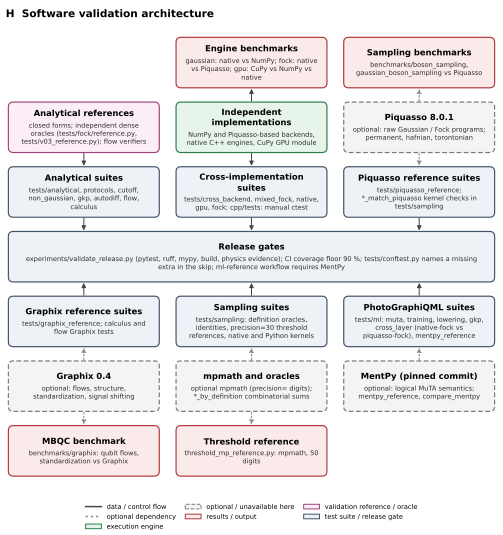

# Architecture figures

The manuscript architecture diagrams A-H are generated from a structured description of
the implemented code. **`docs/architecture/figures.json` is the editable source**: edit
it, never the generated SVG/PDF files.

## Regenerating

```sh
python scripts/generate_architecture_figures.py --check   # validate references only
python scripts/generate_architecture_figures.py           # validate, render, check layout
python scripts/generate_architecture_figures.py --preview build/figure-previews  # plus PNGs
python scripts/generate_architecture_figures.py --report-sizes  # print-size table, writes nothing to docs/
python scripts/generate_architecture_figures.py --report-sizes --preview build/figure-previews
```

Nothing is written to `docs/` while any check fails; use `--preview` (PNG only) or
`--report-sizes` to inspect a failing figure.

**Temporary redesign switch.** `PGQ_FIGURES_SKIP_PRINT_CHECK=1` turns only the
print-readability check (below) into a warning, so the normal render writes the
SVG/PDF files while figures are being redesigned. All other checks still fail the run.
Remove it once `--report-sizes` shows `ok` for every figure:

```sh
PGQ_FIGURES_SKIP_PRINT_CHECK=1 python scripts/generate_architecture_figures.py        # sh
$env:PGQ_FIGURES_SKIP_PRINT_CHECK = "1"; python scripts/generate_architecture_figures.py  # PowerShell
```

Outputs: `docs/figures/architecture/figure_<id>_<slug>.svg` and `.pdf`,
`docs/figures/architecture/captions.md`, and the figure index at the end of this file
(between the `figure-index` markers, rewritten on every run). Output is deterministic:
text is converted to paths (DejaVu Sans), SVG ids use a fixed hash salt and no dates are
written into SVG or PDF metadata.

`tests/unit/test_architecture_figures.py` runs the same validation in the test suite, so
CI fails when a referenced module, class, function, file or C++ symbol disappears.

## What the generator guarantees

- **Every box cites code.** A box without `refs` is an error. References are
  `"module:attr.sub"` (imported and looked up for real), `"path:relative/path"` (must
  exist) or `"path:relative/file#symbol"` (the file must define `symbol`: a top-level
  class, function or assignment in a `.py` file, a whole-word occurrence otherwise, used
  for C++ headers, sources and `CMakeLists.txt`). Edges may carry `refs` for the
  conversion function they are labelled with.
- **No layout defects.** Rendering fails (and writes nothing to `docs/`) if a
  label overflows its box at the smallest allowed font scale, an edge passes through a
  box other than its endpoints, an edge label overlaps a box or another edge label, or the
  legend overlaps the diagram. Labels are word-wrapped
  with measured glyph widths and shrunk only as far as needed. Lane labels must fit their
  band, and edges, edge labels and the legend must keep clear of the lane-label gutter.
- **Readable in print.** Each figure is assumed to be placed at the full text width,
  7.0 in (504 pt), or at its native width if narrower. After the per-box fit scaling and
  this print scaling, box titles and the figure title must be at least 7 pt, and details,
  edge labels, legend entries and lane labels at least 6 pt; otherwise rendering fails.
  `--report-sizes` prints, per figure, the native width, the print scale and the smallest
  effective size in each category.
  All eight figures are 7.0 in wide. Figure A is 9.62 in tall; placed at 6.8 in width it
  is 9.34 in tall and its smallest text is still at least 6.0 pt (edge labels 6.02 pt), so
  it fits a standard text page.
- **Schema checks.** Unique figure and box ids, known kinds, no two boxes in one grid
  cell, valid edge endpoints and ports.

## Specification format

```json
{"id": "A", "slug": "complete_architecture", "title": "...", "caption": "...",
 "cell": [2.55, 1.12],
 "boxes": [{"id": "og", "label": "OpenGraph IR", "detail": "typed Model ...",
            "kind": "ir", "col": 0, "row": 2, "span": 1,
            "refs": ["photographiq.ir:OpenGraph"]}],
 "edges": [{"from": "graphs", "to": "og", "kind": "data", "label": "...",
            "from_port": "s-0.3", "to_port": "n", "bend": 0.0, "label_t": 0.5,
            "label_offset": [0, 0], "refs": ["photographiq.ir:OpenGraph.from_cvgraph"]}],
 "lanes": [{"label": "User API", "rows": [1, 1]}, {"label": "Quantum IR", "rows": [2, 3]}],
 "lane_width": 0.36}
```

Boxes sit on an integer grid (`col`, `row`, `span` columns); `cell` is the cell size in
inches. Edges attach to the facing box sides by default; `from_port`/`to_port` choose a
side (`n`, `s`, `e`, `w`) and an offset along it in units of the side length
(`-0.5..0.5`). `bend` is the matplotlib `arc3` curvature; `label_t` places the label
along the curve.

`lanes` (optional) names the layers of a figure. Each lane has a `label` and `rows`
`[first, last]`, an inclusive range of grid rows (`[r, r]` for one row); lanes must lie
inside the grid and must not share a row, but rows may be left without a lane. Each lane
is drawn as a light grey band across the whole figure with its bold label rotated by 90
degrees in a left gutter. `lane_width` is the gutter width in inches (default 0.36,
enough for two label lines). It is added to the native figure width, so it also lowers
the print scale.

## Conventions

| Box kind | Fill / border | Meaning |
| --- | --- | --- |
| `api` | light blue / blue | user-facing API |
| `ir` | light orange / orange | intermediate representation |
| `compiler` | light violet / violet | compilation, analysis, dispatch |
| `engine` | light green / green | execution engine or numerical kernel |
| `optional` | grey / grey, dashed border | optional dependency, or unavailable on this platform |
| `result` | light red / red | results, outputs, exports |
| `ml` | light teal / teal | PhotoGraphiQML |
| `classical` | light yellow / ochre | classical processing, build tooling |
| `reference` | light pink / magenta | validation reference or oracle (figure H) |
| `test` | light slate / slate | test suite or release gate (figure H) |

| Edge kind | Style | Meaning |
| --- | --- | --- |
| `quantum` | solid dark blue | quantum information / state handed to an engine |
| `classical` | dashed ochre | classical outcomes, corrections, feed-forward |
| `data` | solid grey | data or control flow |
| `optional` | dotted grey | optional dependency |

Platform notes reflected in the figures: Piquasso 8.0.1, Graphix 0.4, JAX and mpmath are
optional (installed in the development environment, never required by the core package);
MentPy is optional and not installed; CUDA-Q has no Windows wheels, so `cudaq-dynamics`
is a registered probe that always raises on construction. The optional CuPy module
`photographiq.gpu` appears in figures A, C and G as a separate, explicitly chosen entry point
(it is not a registered backend); its references are validated like every other box, so renaming its public
classes breaks the figure check until `figures.json` is updated.

## Figure index

<!-- figure-index:start -->

### Figure A: Complete PhotoGraphiQ architecture



Files: [`figure_A_complete_architecture.svg`](../figures/architecture/figure_A_complete_architecture.svg), [`figure_A_complete_architecture.pdf`](../figures/architecture/figure_A_complete_architecture.pdf)

Complete PhotoGraphiQ architecture, read from top to bottom; each labelled band is one layer: user API, quantum IR, compiler, backend planner, numerical engines, results and visualization. PhotoGraphiQML (top band) is an extension above the core, and the bottom band (direct entry points) holds the two entry points that bypass the planner. Solid grey arrows are classical data and control flow, including the Pattern that the planner hands to the engines (a classical description, not a quantum state); dashed ochre arrows carry measurement records and computed results. User API: resource graphs (CVGraph, ClusterState families with explicit squeezing), command patterns with measurement protocols (Homodyne, Heterodyne, Generaldyne, PhotonNumber) and finite-energy inputs (Gaussian, Fock, GKP, cat and cubic-phase), and photonic circuits (Circuit of Gaussian and non-Gaussian gates). Quantum IR: the graph-level OpenGraph (built by OpenGraph.from_cvgraph), whose Model (cv-gaussian, cv-nongaussian, qubit, gkp-logical) fixes the computational model and is never silently changed and which holds one HomodyneSpec or QubitMeasurement per measured node, and the backend-neutral Pattern command IR, whose feed-forward is written as Outcome expressions and which serializes to allowlisted versioned JSON. Compiler: flows.analyze certifies a measurement order (CV flow for cv-gaussian graphs; causal flow, gflow or Pauli flow for qubit graphs) and returns a FlowAnalysisResult, corrected_pattern turns a certified CV order into a Pattern (Figure B), compile_circuit (drawn in the compiler band, with an arrow up to the Pattern IR it produces) lowers circuits to finite-squeezing teleportation patterns by wire steps T(k) and resource injection recorded in a CompilationTrace, and pattern_from_flow yields QubitPatterns that are analysed by photographiq.calculus (standardize, signal_shift, local complementation, a ZX rewrite subset; Figure E) and are not executed by the CV engines. Backend planner: required_features and preflight check a Pattern against the capabilities of the registered BackendInfo entries without allocating a state; simulate runs the backend named by its backend argument (default gaussian) and never selects one itself, while select_backend is an explicit planner that returns the cheapest qualifying backend (Figure G). Numerical engines (Figure C): the NumPy Gaussian reference ('gaussian', exact Schur-complement conditioning), the compiled engines native-gaussian, native-fock and native-mixed-fock of photographiq._native, the optional Piquasso backends (piquasso, piquasso-fock, piquasso-mixed-fock, imported lazily), and a CUDA-Q Dynamics entry that is only a probe (cudaq_probe, cudaq_capabilities; construction raises): CUDA-Q has no Windows wheels, and no PhotoGraphiQ execution is implemented on it. Results: simulate and run_shots return Result and ShotResult trajectories (records, surviving state, diagnostics), and exact analysis provides gaussian_channel, Fock fidelity, Wigner functions and cutoff convergence; together with the sampling results they feed the visualization layer: immutable GraphView stages (construct, flow, corrections, execution) exported as Cytoscape.js HTML or as Matplotlib SVG, PDF or PNG, plus scientific plots. Two entry points bypass the planner: photographiq.sampling (Figure F), whose output_distribution, pnr_distribution, threshold_probability and samplers call the matrix functions (permanent, (loop) hafnian, (loop) torontonian) with backend='auto', that is, the compiled kernels or NumPy implementations of the same algorithms, and return TruncatedDistribution, PNRSamples and threshold click samples; and photographiq.gpu, an optional CuPy module for batched Gaussian kernels (symplectic updates, homodyne conditioning, diagnostics) that is not a registered backend, defaults to device='gpu' and raises instead of falling back to the CPU (device='cpu' runs NumPy only when asked), and records the producing device (Execution) in every batch result (GaussianBatch, BatchValues). PhotoGraphiQML (src/photographiqml) builds on the core with MuTA models of TriangleNeuron blocks, the MuTAClassifier, MuTARegressor and MuTAKernel estimators, the Trainer and, for physical {0, pi} angles, DiscreteSearch. Its logical MuTA models run in its own ideal statevector executor and do not pass through the CV engines; only the capability-audited (physical_capabilities) signed-X GKP lowering lower_muta_to_gkp, which is experimental, emits a PhotoGraphiQ Pattern, executed through run_physical by simulate or run_shots on piquasso-fock (default) or native-fock (Figure D). Dashed boxes and dotted arrows are optional dependencies, never required by the core package: MentPy (an optional comparison of logical MuTA branches, mentpy_reference; not installed here), JAX (fixed-topology differentiable Fock execution, outside the registry), Piquasso, CuPy and CUDA-Q.

### Figure B: CV-MBQC compilation pipeline



Files: [`figure_B_cv_mbqc_pipeline.svg`](../figures/architecture/figure_B_cv_mbqc_pipeline.svg), [`figure_B_cv_mbqc_pipeline.pdf`](../figures/architecture/figure_B_cv_mbqc_pipeline.pdf)

CV-MBQC compilation and execution pipeline for cv-gaussian graphs; the numbers give the order of the stages. Solid dark-blue arrows carry quantum information (mode states), dashed ochre arrows carry classical measurement outcomes and the feed-forward computed from them, and solid grey arrows carry classical compile-time data. (1) Input states are individual GaussianInput, FockInput or non-Gaussian resource descriptions (GKP, cat, cubic phase) for the input nodes (vacuum when omitted); every other node is prepared by Prepare(node, squeezing) with the graph's finite squeezing. (2) The resource graph is a weighted CVGraph or a ClusterState family, which OpenGraph.from_cvgraph turns into the typed OpenGraph IR (Model cv-gaussian) with one HomodyneSpec shear per measured node (supplied by the caller, default 0). (3) Pattern(graph) emits the preparations and one weighted Entangle(u, v, w) (controlled-Z, p_u -> p_u + w q_v) per edge. (4) analyze(open_graph, 'cv') searches a measurement order (search_cv_order) by backward layering with real least squares over the weighted adjacency and certifies it with certify_cv_flow (Booth and Markham, Quantum 7, 1146 (2023)), whose correction vectors c_u satisfy (A c_u)_v = delta_uv, and returns a FlowAnalysisResult; by default (verify=True) analyze then passes the corrected pattern of stage 5 to verify_cv_determinism, which simulates it by exact Gaussian postselection at raised resource squeezing, tracking its gain and noise, and accepts determinism only as an infinite-squeezing (ideal-limit) statement, reporting the finite-squeezing noise and residual outcome dependence separately; a failed check turns the status from 'certified' into 'unknown'. (5) corrected_pattern applies the certified correction map: node u is measured with Homodyne(atan2(1, shear)) and every target t receives Displace(q += c_q m, p += c_p m) with m = record / sin(theta); command_view expresses each correction as an exact affine form (AffineForm) of outcomes, and Pattern.standardize only commutes preparations and CZ across disjoint commands, merges adjacent Displace commands on one node (constants and Outcome expressions are added, callable expressions are kept apart) and drops zero shifts. (6) corrected_pattern already emits the commands in the certified order; Pattern.validate, which simulate calls first, builds the dependency_graph of mode lifetimes and classical record dependencies, rejects cycles and any command that uses an outcome not yet produced, and the backend then executes the validated command order as stored (Pattern.schedule, via topological_schedule, returns an equivalent causal ordering for inspection but is not applied by simulate). (7) During simulate or run_shots the backend measures each node with the stated protocol (Homodyne, Heterodyne, Generaldyne or PhotonNumber) and conditions the remaining modes. (8) Each outcome m becomes a classical record; the Outcome expressions of later Displace and Signal commands are resolved from the records, so feed-forward displaces unmeasured modes before they are measured and applies the final byproduct corrections to the outputs. (9) Output marks the output modes; Result holds the outcomes, records and the surviving output state (ShotResult for run_shots). cv-nongaussian and gkp-logical graphs are reported as 'unsupported' at stage 4, and the qubit counterpart is shown in Figure E.

### Figure C: Simulation architecture



Files: [`figure_C_simulation_architecture.svg`](../figures/architecture/figure_C_simulation_architecture.svg), [`figure_C_simulation_architecture.pdf`](../figures/architecture/figure_C_simulation_architecture.pdf)

Simulation architecture, from the Python API (top) through the simulators and the native loader to the C++ bindings, the pgq_core library and its CPU optimization layers (bottom). Arrows from the public API carry a Pattern and a backend name, which are classical data. Python public API: simulate (default backend 'gaussian'), run_shots and create_backend reach every registered backend by name and select_backend returns one only when called explicitly; photographiq.sampling exposes the boson-sampling and GBS algorithms (permanent, hafnian, torontonian, output_distribution, pnr_distribution, threshold_probability), and photographiq.gpu exposes batched Gaussian kernels (apply_symplectic, condition_homodyne, homodyne_moments, fidelity, purity on a GaussianBatch). The validated Python simulators define measurement, preflight, GKP and diagnostic semantics: the NumPy GaussianBackend (the reference mean and covariance evolution, with exact Schur-complement conditioning) and the Piquasso-based PiquassoFockBackend (pure Fock states: total-photon cutoff, renormalisation diagnostics, PNR, homodyne and GKP readout) and MixedFockBackend (density matrices, loss, local conditioning). The native Gaussian, Fock and mixed-Fock simulators (NativeGaussianBackend with in-place mean and covariance kernels and a batch_* API; NativeFockBackend on NativePureFockState with exact Bargmann gate elements; NativeMixedFockBackend on NativeMixedFockState density matrices) subclass them and replace only state storage and numerical kernels, so this logic is shared rather than reimplemented and native Fock execution never imports Piquasso. They load the compiled engines through photographiq.native, which imports the installed photographiq._native extension (or the file named by PHOTOGRAPHIQ_NATIVE_PATH) and, through require(component), raises an explicit ImportError with build instructions when a component is missing; the core package works without it. C++ bindings: one pybind11 module, PYBIND11_MODULE(_native) with components and build_info, with one binding file and submodule per component (gaussian, fock, sampling) over the static library pgq_core (C++20; conventions hbar = 2, interleaved quadratures, vacuum covariance I); the fock component serves both pure and mixed Fock states. pgq_core provides core (types.hpp conventions with kHbar = 2, symplectic form and residual), gaussian (symplectic updates, channels, homodyne and generaldyne conditioning, diagnostics, batches), fock (total-photon FockBasis, Gaussian unitary elements, cubic phase, local kernels) and sampling (Ryser permanent, hafnian, loop hafnian, torontonians, threshold vacuum sum). CPU optimization layers: Eigen 3.4.0 restricted to MPL-2.0 code, OpenMP loops when the compiler provides them (PGQ_USE_OPENMP), the GIL released during kernels, per-chunk partial sums added in index order with compensated summation (results independent of thread scheduling), and batched and local in-place kernels; scikit-build-core and CMake build the selected PGQ_COMPONENTS (pybind11_add_module(_native)) and the optional C++ unit tests (ctest, PGQ_BUILD_CPP_TESTS). Sampling algorithms (Ryser permanents with multiplicities, power-trace loop hafnians, threshold vacuum-projection sums and the Clifford and Clifford sampler) dispatch with backend='auto' to the compiled kernels or to NumPy implementations of the same algorithms. GPU execution is the separate, optional CuPy module photographiq.gpu: kernels default to device='gpu' and raise ImportError or RuntimeError when CuPy or a CUDA device is missing, device='cpu' runs the same algorithm in NumPy only when asked, so there is no silent fallback; computations default to float64 and every result carries an Execution record naming the device. CUDA-Q integration is limited to the registered cudaq-dynamics probe: cudaq has no Windows wheels, cudaq_capabilities documents the CUDA-Q Dynamics API without having been run, and the backend class raises on construction. Dashed boxes are optional dependencies.

### Figure D: Photonic quantum machine learning



Files: [`figure_D_photonic_qml.svg`](../figures/architecture/figure_D_photonic_qml.svg), [`figure_D_photonic_qml.pdf`](../figures/architecture/figure_D_photonic_qml.pdf)

Photonic quantum machine learning with PhotoGraphiQML (src/photographiqml): one training iteration, read clockwise from the parameterized pattern; the numbers give the stages. (1) A MuTA model is a measurement-based pattern built from TriangleNeuron blocks whose measurement angles alpha.w<wire>.c<column> are stored in a ParameterStore that validates, freezes and unfreezes them; PhysicalMuTA restricts the angles to the signed-X choices 0 and pi. (2, top) The logical representation (representation='logical') is an ideal qubit MBQC pattern with an explicit flow, correction sets and measurement order; (3) execute evaluates it as an ideal statevector by flow-ordered frontier translation and returns a LogicalResult, without any CV engine (MuTA.run_batch returns the output states for a batch of input states); (4) MuTARegressor and MuTAClassifier read the first-wire Z expectation of the output state through a scalar affine head, LogicalResult.expectation evaluates Hermitian observables, and MuTAKernel forms a fidelity Gram matrix. (2, bottom; experimental) The physical representation is admitted only after physical_capabilities has audited every angle against the finite-energy GKP resources of a GKPPhysicalConfig; lower_muta_to_gkp then emits an inspectable PhotoGraphiQ Pattern of GKP logical CZ gates and XY readouts with classical frame signals; (3) run_physical executes it with simulate (physical-conditional) or run_shots (physical-shots) on piquasso-fock (the default) or native-fock, the only validated backends; (4) the analog records are decoded by a nearest-cell GKP decoder into decoded marginals with shot standard errors, which compare_logical_physical compares with the ideal logical target. (5) Losses are the mean squared error (regressor), the logistic loss (classifier) and the state infidelity (quantum-output models); for physical models a classical readout head is additionally fitted by BFGS. (6) The only built-in gradient estimator is finite_difference, central differences with step 1e-6, which Trainer.fit uses unless a validated gradient callable is supplied; no parameter-shift rule and no automatic differentiation are implemented for MuTA. photographiq.autodiff (optional JAX) differentiates fixed-topology core Fock patterns only and does not apply here, because the lowered pattern uses Python callable signals and GKP readouts, which it rejects. (7) Trainer(optimizer='adam' | 'sgd' | 'lbfgs') applies Adam, plain gradient descent (sgd) or L-BFGS-B through scipy.optimize.minimize; categorical physical angles are never given to these optimizers but to DiscreteSearch, a coordinate search over {0, pi} that uses no gradient and records every evaluation. (8) Each path returns its own result: Trainer.fit returns the updated parameter vector x and a History of losses, gradient norms, parameter norms and wall-clock times (including the initial point), and DiscreteSearch.fit returns a DiscreteSearchResult with the selected {0, pi} parameters, their loss, every evaluation and the seed; ParameterStore.bind maps a parameter vector onto the named, unfrozen angles, and the updated parameters start the next iteration.

### Figure E: Graph-theoretic compilation



Files: [`figure_E_graph_compilation.svg`](../figures/architecture/figure_E_graph_compilation.svg), [`figure_E_graph_compilation.pdf`](../figures/architecture/figure_E_graph_compilation.pdf)

Graph-theoretic compilation from an open graph to an executable measurement pattern; the numbers give the stages. Below the shared flow analysis, the left column is the qubit route and the right column the CV route; the middle columns hold the remaining qubit flow notions and the graph-state analysis tools. (1) The OpenGraph holds vertices, weighted edges, ordered inputs and outputs, one measurement specification per measured node (QubitMeasurement with a Plane and angle, or HomodyneSpec) and its Model; cv-nongaussian and gkp-logical graphs are reported as 'unsupported'. (2) analyze applies only the flow notion of the graph's model: causal flow, plane-aware gflow and Pauli flow over GF(2) on the unweighted adjacency for qubit graphs, each maximally delayed and checked by an independent verifier against its defining conditions before it is returned, and the real-linear CV flow on the weighted adjacency for cv-gaussian graphs (search_cv_order by real least squares, then certify_cv_flow), which by default (verify=True) is certified only after verify_cv_determinism has checked the corrected finite-squeezing pattern by exact Gaussian postselection, a statement about the infinite-squeezing limit; qubit flows are never used as CV determinism certificates. (3) Every analysis returns a FlowAnalysisResult with status certified, not_certified (no certificate for that flow notion, never a proof of nondeterminism), unknown or unsupported, the measurement order and layers and the correction map. (4) pattern_from_flow writes the corrections of measured qubits into the s- and t-domains of their M commands and the corrections of output qubits as X and Z commands, so its result is already in standard N, E, M, X, Z form; corrected_pattern measures each node with Homodyne(atan2(1, shear)) and writes the CV correction vectors as outcome-dependent Displace feed-forward q += c_q m, p += c_p m (Figure B). (5) standardize brings any QubitPattern, for example a hand-written or composed one, to NEMC form with the Danos-Kashefi-Panangaden rewrite rules (rewrite_at applies one), preserving the map branch by branch; for CV patterns Pattern.standardize only commutes preparations and CZ across disjoint commands and does not promise an N-E-M-X-Z normal form. (6) The implemented optimizations are equivalence-preserving rewrites, not a cost-driven optimizer: signal_shift moves the outcome-flipping part of each measurement domain (the t-domain of XY measurements, the s-domain of XZ and YZ measurements) into signals (S commands), with the same choice as Graphix 0.4; on the CV side Pattern.standardize only merges adjacent Displace commands on one node (constants and Outcome expressions are added, callable expressions are kept apart) and drops zero shifts. Local complementation (local_complement, with its local Clifford witnesses from lc_cliffords and lc_equivalence) and a sound, scalar-exact ZX rewrite subset (fuse, remove_identity, color_change, bialgebra, hopf, copy_state, and simplify_spiders, which applies fusion, self-loop and identity removal to a fixed point; each rule checked by tensor equality in the tests) analyse graph states (graph_state_diagram) and individual pattern branches (pattern_branch_diagram) but are not extracted back into patterns, and cv_local_complementation raises NotImplementedError because no CV analogue has been derived; there is no CV graphical calculus. (7) A QubitPattern is executed branch by branch (run_branch) as exact dense Kraus maps (at most MAX_QUBITS = 20 simultaneously live qubits plus inputs), from which is_deterministic and equivalent decide strong determinism and equivalence; it is an analysis object and is not run by the CV engines. A CV Pattern is checked by Pattern.validate (every Outcome is read only after it is produced) and executed in command order by simulate or run_shots; Pattern.schedule (topological_schedule) returns a causally valid order of its command DAG. Graphix 0.4 is an optional cross-check used only by the test suite and benchmarks, where its semantics coincide.

### Figure F: Boson sampling algorithms



Files: [`figure_F_boson_sampling.svg`](../figures/architecture/figure_F_boson_sampling.svg), [`figure_F_boson_sampling.pdf`](../figures/architecture/figure_F_boson_sampling.pdf)

Boson sampling algorithms (hbar = 2, interleaved quadratures), read from top to bottom: states, interferometer, detection, probability, matrix function and kernel dispatch. Left column: Fock-state boson sampling. An input occupation pattern s (one entry per mode) enters an interferometer given by a unitary U checked by check_unitary (Haar-random from haar_unitary, or user-supplied; clements_decomposition expresses it as a rectangular mesh of mzi elements); an output pattern t is either one of the C(n+m-1, n) patterns enumerated by output_patterns or a sample, drawn exactly by the Clifford and Clifford algorithm B for collision-free inputs or by enumeration of the full output distribution. Its probability is permanent-based: transition_amplitude = Perm(U_{t,s}) / sqrt(prod s! prod t!), evaluated with Ryser's formula with row and column multiplicities. Middle columns: Gaussian boson sampling. Any PhotoGraphiQ GaussianState can be detected; the standard GBS state squeezed_interferometer_state applies single-mode squeezing r_i to vacuum, the passive Gaussian interferometer passive_symplectic(U) of the same unitary U, per-mode pure loss (apply_loss) and finally an optional coherent displacement of the outputs. With photon-number-resolving detection, gbs_matrices converts the state into the complex-amplitude matrices sigma_Q, A, gamma and the vacuum probability p_0, and pattern probabilities are loop hafnians of A (hafnians for zero displacement; for pure states the squared modulus of a half-size (loop) hafnian; power-trace algorithm); pnr_distribution and sample_pnr enumerate all patterns with total photon number below the cutoff and report the retained mass. With threshold detection, threshold_probability uses an equivalent real deviation form of the inclusion-exclusion sum over vacuum projections that conditions on the dark modes and computes each term through expm1 and log1p, returns an estimated relative rounding error (ThresholdPrecisionWarning above 1e-6) and can be evaluated with mpmath at a chosen number of digits (precision=digits, at least 16); sample_threshold samples exactly from all 2^m click probabilities. Torontonian and loop torontonian are provided as separate matrix functions (subset sums in block (a, a^dag) order). Every matrix function dispatches with backend='auto' to the compiled photographiq._native.sampling kernels (OpenMP; per-chunk partial sums added in index order with compensated summation, so results do not depend on thread scheduling) or to NumPy implementations of the same algorithms, and *_by_definition oracles evaluate the defining combinatorial sums for small sizes. mpmath is optional.

### Figure G: Numerical backend selection



Files: [`figure_G_backend_selection.svg`](../figures/architecture/figure_G_backend_selection.svg), [`figure_G_backend_selection.pdf`](../figures/architecture/figure_G_backend_selection.pdf)

Numerical backend selection from required operations and supported capabilities. Three bands group the figure: capability planning (top), the registered backends (middle) and the explicit GPU path (bottom). required_features scans a pattern, its inputs, an optional correlated initial state and optional postselected outcomes without allocating any state and returns the backend capability names it needs plus the DERIVED_FEATURES mixed_gaussian_input and correlated_gaussian_state, which missing_features decides from the backend class (mixed Gaussian inputs need a non-Fock or mixed-Fock backend, correlated Gaussian states a GaussianBackend subclass). Each registered backend is a static BackendInfo in BACKENDS (import path, representation, implementation family, device, precision, differentiability, cutoff use, declared approximations, required Python packages and compiled components); capabilities are read from the backend class, never duplicated in the registry. select_backend tries the candidates in cost order (representation gaussian < pure-fock < mixed-fock < bosonic-dynamics, then the prefer order of implementation families, default native before numpy, then registration order) and accepts the first that is available, covers every required feature, has a cutoff when it needs one and passes the same preflight that simulate runs; it returns a BackendSelection with an explanation and the rejected cheaper candidates, whose name can be passed to simulate, or raises NotImplementedError listing every candidate's rejection reason. simulate never selects a backend: it runs the one named by its backend argument (default 'gaussian') or a supplied instance, after the same preflight and before allocation. The eight registered backends are drawn in select_backend's default candidate order: cost increases from left to right and, within a column, candidates are tried from top to bottom (native, numpy, piquasso). The vertical arrows show only this select_backend order (each points to the next candidate); the grey arrows from simulate carry the Pattern, a classical description, to whichever backend is named, and simulate never moves on to another candidate. Piquasso backends are an optional dependency (installed here); cudaq-dynamics, the only registry entry with device 'gpu', is registered for discovery only (no Windows wheels; its class raises on construction). GPU execution is chosen explicitly instead: photographiq.gpu is not a registered backend and select_backend never returns it; its kernels default to device='gpu' and raise ImportError or RuntimeError when CuPy or a CUDA device is missing, never falling back silently, device='cpu' runs the NumPy implementation of the same algorithm only when asked, and every result records the device that produced it.

### Figure H: Software validation architecture



Files: [`figure_H_validation_architecture.svg`](../figures/architecture/figure_H_validation_architecture.svg), [`figure_H_validation_architecture.pdf`](../figures/architecture/figure_H_validation_architecture.pdf)

Software validation architecture. The release gates are the central band and all test suites feed them. Above and below the gates, each column pairs a validation reference with the test suites that use it (next to the gates) and, where they exist, the benchmarks that report agreement with it (outer rows): analytical references, independent implementations and Piquasso above; Graphix, mpmath with the *_by_definition oracles, and MentPy below. Analytical references: closed forms (vacuum, squeezing, beam splitters, loss, nullifiers, homodyne postselection, cat photon counting, analytical gradients) and independent dense oracles that never import production numerical helpers (tests/fock/reference.py, tests/v03_reference.py), together with the independent flow verifiers and exact tensor equality for the measurement calculus. Independent implementations: the NumPy and Piquasso-based Python backends, the native C++ engines and the CuPy GPU module are compared with each other on identical patterns and states (tests/cross_backend, mixed_fock, native and gpu; the C++ kernels also have their own ctest unit tests, built with PGQ_BUILD_CPP_TESTS and run by hand, not by the release gates), with tolerances justified by cutoff convergence where a Fock truncation is involved. Piquasso 8.0.1, Graphix 0.4, mpmath and MentPy are optional references, never required by the core package: Piquasso for raw Gaussian and Fock references and permanent, hafnian and torontonian kernels; Graphix for flows, pattern structure, standardization and signal shifting where its semantics coincide; mpmath for threshold probabilities at 30 digits in the tests and 50 digits in benchmarks/gaussian_boson_sampling/threshold_mp_reference.py; and MentPy, at a pinned commit, for the logical MuTA semantics. The *_by_definition oracles evaluate the defining combinatorial sums for small sizes. tests/conftest.py turns only the exact ImportError raised for a missing optional extra into a skip that names the extra; CI installs the dev and autodiff extras (Piquasso, Graphix, mpmath, JAX; not CuPy, so the GPU tests run only with device='cpu' there), runs experiments/validate_release.py (pytest with coverage, ruff lint and format, mypy, package build and the physics-evidence script, each with its own log) and enforces a measured coverage floor of 90 percent, and the separate ml-reference workflow fails instead of skipping when MentPy is missing. Benchmarks record environment metadata and a correctness value against a reference for every timing row; smoke runs of the sampling, native Gaussian and Graphix benchmarks are part of the test suite.

<!-- figure-index:end -->
