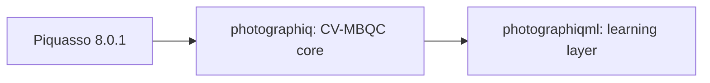

# Unified repository integration report

> **Historical record.** Branch names, versions and source paths below refer to the time of writing (the `merged` branch; source repositories on `manuscript-experiments`). Current development is on the `upgraded` branch (version 0.3.1); see the [master validation status](../validation/MASTER_VALIDATION_STATUS.md) for the current state.

This page records how PhotoGraphiQML and selected CV-MBQC material from
photonic-qrc-eoc were integrated into PhotoGraphiQ on the local `merged` branch
(working-tree changes; nothing committed). It is the single reference for what
was merged, what was rejected and what was actually executed.

## Sources

| Repository | Branch | Commit | Role |
| --- | --- | --- | --- |
| [PhotoGraphiQ](https://github.com/chinmoybiswasdeep/PhotoGraphiQ) | `manuscript-experiments` | `72bcf44f0d76a86422b2a233833a145b6191b151` | Destination and foundational architecture (`merged` started at this commit) |
| [PhotoGraphiQML](https://github.com/chinmoybiswasdeep/PhotoGraphiQML) | `manuscript-experiments` | `5e96e335c33dc52fe0179a949d96a4a3662fcdec` | Integrated completely as the `photographiqml` package |
| [photonic-qrc-eoc](https://github.com/chinmoybiswasdeep/photonic-qrc-eoc) | `CV` | `493f4c3f186ee314796964d6ddb6b2749171b7bb` | Audited selectively; only validated, general CV-MBQC ideas used |

All three are MIT licensed, Copyright (c) 2026 Chinmoy Biswas (the PhotoGraphiQ
and PhotoGraphiQML `LICENSE` files are byte-identical). Code and test oracles
adapted from photonic-qrc-eoc carry an attribution comment naming the notebook
and cell.

## Architecture

- One distribution (`photographiq` 0.3.1, hatchling) ships both import packages:
  `packages = ["src/photographiq", "src/photographiqml"]`.
  `pip install -e ".[dev]"` installs both; verified by importing them from outside
  the repository.
- `photographiq` owns states, graphs, patterns, compilation, measurement,
  feed-forward, finite squeezing, backends, GKP and validation. It never imports
  `photographiqml`.
- `photographiqml` (still `__version__ = "0.2.0"`) owns ansätze, parameters,
  training, kernels, models, expressivity diagnostics and the GKP lowering. It
  uses only public top-level `photographiq` names; its runtime contract check
  (`photographiqml.lowering.check_photographiq_contract`) is unchanged.
- The authoritative interface is [photographiqml-contract.md](photographiqml-contract.md).
  The PhotoGraphiQML core pin (`db07f9f`) remains valid: `src/photographiq` at
  that commit is byte-identical to the merge base.
- No physics is duplicated across the packages beyond what the audit found
  intentional: PhotoGraphiQML's ideal qubit executor (`logical.py`) is a separate
  logical model, and every GKP, homodyne, decoder, CZ and joint-readout operation
  comes from `photographiq`.

Optional extras: `validation` (Graphix), `autodiff` (JAX), `ml-validation`
(MentPy 0.1.0a15), `ml-experiments` (Matplotlib, scikit-learn), `visualization`,
`docs`, `dev` (now also `nbformat`, needed by the ML evidence tests). PhotoGraphiQML's
former `validation` extra was renamed `ml-validation` so that `validation` keeps
its PhotoGraphiQ meaning.

## PhotoGraphiQML placement

Tracked PhotoGraphiQML files were copied byte for byte (826 files) into
namespaced locations; no `.git` data, submodule or history was imported.

| PhotoGraphiQML | Unified repository |
| --- | --- |
| `src/photographiqml` | `src/photographiqml` |
| `tests/` | `tests/ml/` (`muta/test_visualization.py` renamed `test_muta_visualization.py`: pytest basename collision) |
| `paper_experiments/` | `paper_experiments_ml/` (one level deep keeps its `ROOT.parent == repo` invariant) |
| `experiments/`, `examples/`, `docs/`, `scripts/`, `notebooks/` | same names with an `ml/` subdirectory |
| `paper/`, `papers/` | same paths (no collision) |
| `CHANGELOG.md`, `ROADMAP.md` | `docs/ml/` |
| root `coverage.json`, `validation-results.json`, `environment-versions.json` | `validation/photographiqml/` (historical release records) |
| `.gitattributes` | repository root (LF policy needed for its byte-hashed evidence; caused no `git status` changes) |
| `LICENSE`, `CODE_OF_CONDUCT.md`, `CONTRIBUTING.md`, `SECURITY.md`, `CITATION.cff`, `mkdocs.yml`, `pyproject.toml`, `README.md`, CI | not copied; merged into the PhotoGraphiQ equivalents |

Path and provenance edits (minimal, recorded results untouched):

- `tests/ml`: repository-root index fixes; `cross_layer/test_contract.py` now
  asserts the unified wheel ships both packages and has no self-dependency
  (it previously asserted the standalone `photographiq>=0.3.1,<0.4` pin).
  Exact-version and `REQUIRED_API` assertions are unchanged.
- `paper_experiments_ml/publication.py`, `metadata.py`, `run_all_full.py`,
  `build_notebook.py`, `generate_status.py`, `README.md`: in-repo core commit
  instead of a sibling checkout; source fingerprint scoped to ML-owned paths plus
  `src/photographiq` and packaging. See its README "Provenance in the unified
  repository".
- `scripts/ml/*`: anchored at the repository root and retargeted to `docs/ml`,
  `examples/ml`, `notebooks/ml`, so they cannot overwrite PhotoGraphiQ docs.
- `src/photographiqml/validation.py`: install hint now names
  `photographiq[ml-validation]`; `compare_mentpy` gives the same helpful error.
- `src/photographiqml/{gkp,lowering,parameters,physical}.py`: import grouping
  only (ruff I001, since `photographiq` is now first-party).
- `experiments/check_photographiqml_gkp.py`: uses the in-repo package; it now
  asserts that the legacy resource-only bridge still refuses execution.
- `.github/workflows/ml-reference.yml`: optional MentPy reference job; the main CI
  already runs all of `tests/`, including `tests/ml`.

## Manuscript experiments

| Suite | Directory | IDs | Recorded results |
| --- | --- | --- | --- |
| PhotoGraphiQ | `paper_experiments/` | cite as PGQ-R1 … PGQ-R42 | unchanged |
| PhotoGraphiQML | `paper_experiments_ml/` | cite as PGML-R1 … PGML-R59 | byte-identical to source (639 of 645 files; the 6 differing files are the path/provenance modules listed above) |

PhotoGraphiQML evidence fingerprints are path-keyed. They were already stale at
the source HEAD and cannot match in the unified tree until a fresh
`python paper_experiments_ml/run_all_full.py --publication` run (needs the
`ml-validation` and `ml-experiments` extras). `verify_evidence.py` confirms all
354 artifact SHA-256 hashes still match. The derived manuscript notebook was not
regenerated.

## Extracted from photonic-qrc-eoc

Only six notebooks were audited (0b, 0c, 1, 2a, 2b, 2c). Every CV convention in
them agrees with PhotoGraphiQ (hbar = 2, interleaved quadratures, vacuum
covariance I, p-squeezed resources, `q cos θ + p sin θ` homodyne, CZ `p_u += g q_v`,
calibrated inefficient homodyne). Nothing reservoir-specific was imported.

| Item | Source | Decision | Result |
| --- | --- | --- | --- |
| Gaussian postselection, outcome densities and `log_likelihood` | 2b `RefInterpreter`, 1 Kalman update | **Adapted** into `GaussianBackend.measure(..., outcome=)` and `simulate` statistics | Closes a confirmed gap; Homodyne, Heterodyne, Generaldyne |
| Covariance symmetry drift (deep or strongly squeezed circuits failed `validate`) | exposed by 0b/0c symmetrisation | **Bug fix**: re-symmetrise after every Gaussian/Piquasso gate | Previously failed at r ≈ 7–8 or ~500 random gates |
| Mixed-state Gaussian fidelity, purity, symplectic eigenvalues, entropy, log-negativity | 0b `gaussian_fidelity`, 1 cell 93 | **Adapted** as `GaussianState` methods | Notebook formulas kept as independent test oracles |
| `QuadraticPhase` in `gaussian_channel` | 0b test 06 | **Adapted** | Outcome-dependent shears still rejected |
| `pg.cvflow` export and multimode CV-flow channel test | 0b `paper_U` | **Test oracle** | chain, ring, 2NN at r = 0.5, 1.5 |
| Finite-squeezing teleportation Kraus map | 2c | **Test oracle only**: already simulated natively | Native wire agrees to 1−F ≈ 3e-14 |
| Wigner negativity convention | 2c | **Documented**: `negative_volume` = ½ δ_KZ | Notebook `wigner_grid` found to return W(q, −p); not reused |
| Reservoirs, García-Beni loop model, echo-state/memory, Lyapunov, edge-of-chaos, DV/Perceval, Kerr meter models, samplers, statistics, checkpoints, sweeps, saved results | all | **Excluded** | Out of scope |
| Phase-jitter channel, batched Kalman adapters | 2a, 2b | **Excluded** | Reservoir-specific structure; jitter formula valid only for one layer |
| Quadratic-phase absorption into the next homodyne basis | 2c | **Deferred** | Valid only for ideal detectors; would change compiler output |
| Ideal-resource channel limit, (P, A)↔symplectic converter | 0b, 0c | **Deferred** | Correct but not needed by current features |
| Notebook Piquasso ħ = 1 mean conversion | 0c, 1 | **Rejected** | Off by 1/√2; PhotoGraphiQ's `import_state` is correct |

New tests: `tests/protocols/test_gaussian_postselection.py`,
`tests/protocols/test_covariance_symmetry.py`,
`tests/analytical/test_gaussian_diagnostics.py`,
`tests/analytical/test_cvflow_multimode.py`,
`tests/non_gaussian/test_finite_squeezing_kraus_reference.py`,
`tests/non_gaussian/test_nongaussianity_conventions.py`. Each compares to an
independent reference: Piquasso Fock or mixed-Fock postselection, closed forms,
notebook formulas, or an explicit product of symplectic matrices.

## Conventions and interface decisions

- Gaussian `measurement_statistics` entries are **densities** of calibrated
  records (`kind: "density"`), tagged `postselected`. `log_likelihood` is a joint
  density, not a probability, and a postselected run is one conditional branch.
  A postselected record with numerically zero density raises, as on Fock backends.
- In `simulate(frame=True)` a postselected value is the user-visible record
  (including the deferred frame shift); the engine is conditioned on the shifted
  value, and the density is translation invariant.
- `GaussianState.fidelity` is the squared Uhlmann fidelity. It uses the exact
  `Tr ρσ` when either state is pure; the general formula loses about 1e-6 at
  r ≈ 3 near purity. Symplectic eigenvalues use a Cholesky-based Hermitian form.
  In float64, purity is not resolvable for rotated squeezing much beyond r ≈ 3–4.
- `log_negativity` uses log base 2; `entropy` uses nats.
- `WignerGrid.negative_volume` is ∫max(−W, 0) = ½ δ_KZ.
- PhotoGraphiQML conventions are unchanged: logical measurement applies
  `H·exp(+iαZ/2)` (positive exponent); training uses central finite differences;
  parameter shift is a test oracle only. Physical MuTA supports only intermediate
  angles 0 and π modulo 2π (absolute tolerance 1e-14), unit CZ, product inputs and
  the `piquasso-fock` backend, so it is Clifford-only. Arbitrary physical XY is
  rejected before Fock allocation.

## Validation executed (Python 3.12.14, Windows)

| Command | Result |
| --- | --- |
| baseline `python -m pytest -q` on `72bcf44` before changes | 533 passed |
| `python experiments/validate_release.py --output <tmp>` (full `pytest` with coverage of both packages, ruff, ruff format, mypy, build, physics evidence) | pytest **689 passed, 2 skipped** (MentPy absent); mypy clean on both packages; wheel and sdist built; physics evidence ok; coverage 93% (core 93%, ML 95%) |
| same validator, `ruff check` and `ruff format --check` | fail only on the pre-existing, unmodified `examples/tutorials/tutorials.ipynb` (I001, E702, formatting) |
| `paper_experiments/run_all_safe.py` (scratch copy) | 24 run, 24 passed, 18 skipped by the runner (heavy Fock, long benchmarks, optional deps) |
| same subset with pristine `72bcf44` core vs integrated core | all outputs bit-identical, except one round-off error metric in R15 (Δ = 1.1e-16 on values ≤ 7e-16) from re-symmetrisation |
| `paper_experiments_ml/run_all_safe.py` (scratch copy) | 37 run, 25 passed, 12 failed (MentPy: R7–R13, R20, R21; scikit-learn: R23, R24, R50), 22 skipped; the 25 regenerated results reproduce the recorded values exactly |
| `paper_experiments_ml/verify_evidence.py --json` | all 354 artifact hashes match; fingerprints stale (expected, see above) |
| `python -m mkdocs build --strict` (output outside the repository) | built with no warnings, including the new PhotoGraphiQML section |

Not executed: the heavy or long PhotoGraphiQ experiments, `run_all_full.py` for
either suite, the MentPy reference tests and the scikit-learn experiments.

## Known limitations and open items

- The recorded PhotoGraphiQ R1/R2 JSON (commit `6d49da0`) has a different schema
  from what the current R1 script produces (the script was last changed in
  `362da97`). This predates the merge and was left untouched; regenerate those
  results from the scripts before citing them.
- PhotoGraphiQML evidence must be regenerated in the unified tree for valid
  fingerprints, in an environment with MentPy and scikit-learn.
- `BaseBackend.measure` does not declare the new `outcome` keyword. Gaussian
  outcome type checks differ slightly between frame and non-frame mode; all bad
  inputs still raise.
- `GaussianState.validate` uses absolute tolerances, so circuits whose
  anti-squeezed variances reach ~1e8 can still fail validation.
- `cvflow.flow_pattern` does not append an `Output` command. Graphs whose node
  order differs from the declared output order fail validation.
- Six `paper_experiments_ml` scripts have I001 import-order lint. They were left
  unchanged to preserve script provenance.
- `photographiqml` is recorded as version `None` in experiment metadata, because
  it is no longer a separate distribution.
