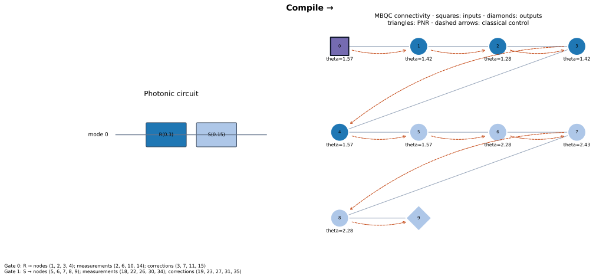

# PhotoGraphiQ

**Build, simulate and analyse continuous-variable photonic MBQC in Python.**

PhotoGraphiQ (version 0.3.1) connects optical circuits to weighted cluster resources,
adaptive homodyne measurements and classical feed-forward. It answers questions such as:
what state survives a measurement pattern, how much noise finite squeezing adds to a
compiled gate, whether a graph admits deterministic corrections, and whether a non-Gaussian
result has converged with the Fock cutoff.

## Start with an experiment

[Install from source](getting-started/installation.md) (the guide ends with a check that runs
the NumPy, native Gaussian and native Fock engines), then follow the
[five-minute quickstart](getting-started/quickstart.md). You will prepare an input, measure a
cluster, correct the output and draw the computation.

## What is inside

| Layer | Capability | Guide | Theory |
|---|---|---|---|
| Resources | weighted CV graphs with finite squeezing, open-graph IR | [graphs](user-guide/graphs.md) | [cluster states](theory/cluster-states.md) |
| Patterns | prepare, entangle, measure, correct; symbolic feed-forward | [patterns](user-guide/patterns.md), [feed-forward](user-guide/feedforward.md) | [Gaussian](theory/gaussian.md) |
| Compilation | Gaussian circuits → teleportation steps; Gaussian-plus-cubic target | [compilation](user-guide/compilation.md) | [compilation](theory/compilation.md) |
| Simulation | NumPy and native C++20 Gaussian, pure-Fock and mixed-Fock engines | [backends](user-guide/backends.md) | [Fock](theory/non-gaussian.md) |
| Flow | causal flow, gflow, Pauli flow; CV flow with exact witnesses | [flow](user-guide/flow.md) | [flow](theory/flow.md) |
| Calculus | measurement calculus, local Cliffords, qubit ZX subset, Gaussian graphical calculus | [MBQC calculus](user-guide/mbqc-calculus.md) | [calculus](theory/calculus.md) |
| BS/GBS | permanents, hafnians, torontonians, samplers | [sampling](user-guide/sampling.md) | [sampling](theory/sampling.md) |
| GKP | finite-energy codewords, readout, decoding, logical gates | [GKP](user-guide/gkp.md) | [GKP](theory/gkp.md) |
| Visualization | static figures; interactive, draggable graph, flow and correction views | [visualization](user-guide/visualization.md), [interactive](user-guide/interactive.md) | — |
| Acceleration | CuPy batched kernels; CUDA-Q Hamiltonian adapter (execution unverified) | [GPU](gpu.md), [CUDA-Q](cudaq.md) | — |
| Learning | PhotoGraphiQML: MuTA models and GKP lowering | [PhotoGraphiQML](ml/index.md) | — |

The core depends only on NumPy, SciPy and NetworkX plus its compiled extension. Piquasso is
an optional reference simulator (`photographiq[piquasso]`) used for cross-validation; the
default engines are PhotoGraphiQ's own. The `photographiqml` learning layer ships in the same
distribution; the core never imports it.

## Research status

Each feature carries a status: **validated** against an independent reference,
**experimental**, **restricted** to a stated subset, or **unsupported** (rejected by the code).
The [master validation status](validation/MASTER_VALIDATION_STATUS.md) and the
[complete functionality reference](COMPLETE_FUNCTIONALITY.md) list them; the
[feature matrix](validation/feature-matrix.md) is the per-backend view. The current upgrade was
validated locally on Windows (2026-11-12) and has not yet been re-run on remote CI.

Graphix checks MBQC **structure**: labels, edges, measurement order and classical
dependencies. It does not validate continuous-variable amplitudes or quadrature statistics.
[Learn about the validation stack](validation/index.md).

## Choose your path

| Use the package | Understand or extend it |
|---|---|
| [Quickstart](getting-started/quickstart.md) | [Conventions](getting-started/conventions.md) |
| [Inputs](user-guide/inputs.md) and [outputs](user-guide/outputs.md) | [Theory](theory/index.md) |
| [Tutorials](tutorials/index.md) and [projects](examples/index.md) | [Architecture](development/architecture.md) and [figures](architecture/README.md) |
| [API reference](api/index.md) | [Validation](validation/index.md) and [performance](performance.md) |
