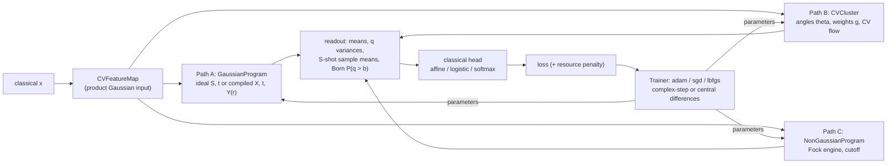

# Architecture

## Pipeline

The quantum part runs from the encoded state to the readout statistics. The head, loss,
penalty and optimiser are classical. Resource accounting (`resource_report`) is kept
separate from the objective, except for the optional penalty term.

## Modules

| Module | Contents |
| --- | --- |
| `gaussian.py` | `Feature`, `CVFeatureMap`, `GaussianProgram`, `layered_program`; ideal and compiled moment propagation |
| `mbqc.py` | `CVCluster`: weighted grid cluster, angle parameterisation, CV-flow certificate cache, forward-substitution channel, `flow_pattern` |
| `learning.py` | `CVRegressor`, `CVClassifier`, `CVTrainingHistory`, `complex_step_gradient`, `central_difference` |
| `kernels.py` | `CVKernel` (overlap, normalized, fidelity) from closed-form Gaussian-state overlaps |
| `nongaussian.py` | `NonGaussianProgram` (Kerr, cubic phase) on the Fock engine; cubic resource-injection lowering |
| `resources.py` | `pattern_resources`, `resource_report` |

## Reuse of PhotoGraphiQ and PhotoGraphiQML

- `photographiq.Circuit.compile` / `compile_circuit` build the compiled Path A pattern.
  `GaussianProgram.channel(mode="physical")` mirrors that lowering step by step.
- `photographiq.cvflow.certify_cv_flow` and `flow_pattern` provide the Path B
  certificate and executable pattern.
- `photographiq.analysis.gaussian_channel` is the independent reference for both channels
  in the tests.
- `photographiq.GaussianState` (`overlap`, `purity`, `fidelity`) evaluates the kernels.
- `photographiq.simulate(..., backend="native-fock")` and
  `photographiq.fock_analysis.quadrature_moment` run and read Path C.
- `photographiqml.training.Trainer` is the optimiser. Its histories include the initial
  point.

## Backends

| Object | Moment evaluation used in training | Executable artefact | Engines that run the artefact |
| --- | --- | --- | --- |
| `GaussianProgram`, ideal | In-package NumPy (S, t) | `gate_pattern(params, x)` | `gaussian`, `native-gaussian` (tested) |
| `GaussianProgram`, physical | In-package mirror of the compiler (X, t, Y) | `circuit(params, x).compile(squeezing=r)` | `gaussian` (trajectories, `photographiq.run_shots`) |
| `CVCluster` | In-package forward substitution (X, Y) | `pattern(params, squeezing=r)` | `gaussian` (trajectories) |
| `NonGaussianProgram` | Fock engine (`native-fock` default) | `pattern(params, x, cubic=...)` | `native-fock`; Gaussian engines reject Kerr/cubic commands |

Training never samples patterns. It uses the exact moments, or the reparameterised shot
estimator built from them ([training](training.md)).
