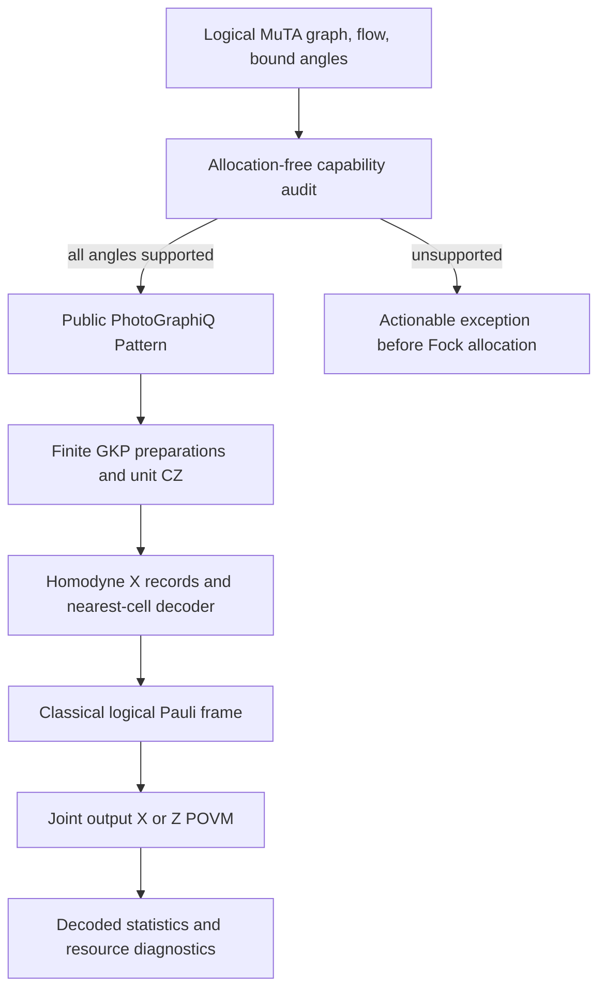

# Physical GKP architecture

PhotoGraphiQML 0.2.0 adds physical execution of MuTA's **signed-X subset**.
Logical MuTA remains the qubit reference model, validated against MentPy.
CVMuTA remains a separate derivation proposal: replacing triangle vertices with
oscillators does not establish the same model or a continuous-variable generalization.

## Dependency contract

The runtime requirement is `photographiq>=0.3.1,<0.4`. CI pins
[`db07f9f9bf47da841bfa6b206562c5a3ffb121d3`](https://github.com/chinmoybiswasdeep/PhotoGraphiQ/tree/db07f9f9bf47da841bfa6b206562c5a3ffb121d3).
`check_photographiq_contract()` checks the installed version and public symbols.
The audited upstream contract lives in
[`docs/development/photographiqml-contract.md`](https://github.com/chinmoybiswasdeep/PhotoGraphiQ/blob/db07f9f9bf47da841bfa6b206562c5a3ffb121d3/docs/development/photographiqml-contract.md).
No private encoded-state, decoder, or backend implementation is imported.

## Representations and migration

| API | Meaning | Execution |
| --- | --- | --- |
| `MuTA(..., representation="logical")` | Ideal qubit graph and adaptive flow | Arbitrary supported logical XY angles |
| Legacy `representation="gkp"` | Resource-only v0.1 intent; deprecated alias | Keeps its execution exception |
| `representation="gkp-resource"` | Explicit resource-only model | Ideal target through `GKPBridge.logical_target` |
| `PhysicalMuTA(...)` | `gkp-physical`, finite resources | Audited 0/pi family only |

`GKPBridge.run(logical_model, ..., config=...)` is an explicit request to lower
a fixed logical pattern; it performs the same preflight as `PhysicalMuTA.run`.
Loading a schema-1 resource model never silently converts it to physical execution.
Schema 2 stores the physical family and every resource/allocation setting.

## Resource model

`GKPPhysicalConfig` specifies cutoff, peak width, envelope, peak count,
integration grid, backend, decoder, dimension budget and matrix budget.
`GKPCode.encode` builds normalized finite codeword superpositions. Nonorthogonal
finite codewords do not define an exact isometric DV-to-CV encoding channel.
Product logical inputs are supported; entangled input vectors fail before projection.
Entangled output states are retained and receive joint readout.

The validated backends are `piquasso-fock` (the default, kept for reproducibility
of earlier results) and `native-fock`. Set `GKPPhysicalConfig(backend="native-fock")`;
it needs the compiled `photographiq._native` fock component. The two engines run the
same Python preparation, homodyne readout, renormalisation and diagnostics code. They
differ only in how a CZ is truncated: `native-fock` applies the exact projected operator
P U P, while Piquasso applies Euler factors and truncates after each one. Both converge
to the same state as the cutoff grows (`tests/ml/cross_layer/test_native_backend.py`,
`tests/native/test_native_fock_cross_layer.py`).

Measured at cutoff 32 with peak width and envelope 0.9, four peaks, random signed-X
angles, random product inputs and analog outcomes, seeds 0 to 2:

| Wires | max \|ΔP\| decoded, piquasso vs native | 1 − F final state | Each engine's own error vs cutoff 44 |
| --- | --- | --- | --- |
| 1 | 1.2e-6 to 7.9e-5 | ≤ 1.3e-7 | 3.4e-6 to 6.5e-5 |
| 2 | 1.4e-5 to 9.0e-5 | ≤ 1.5e-7 | 4.9e-5 to 1.0e-4 |

The engine difference is of the same order as the engines' truncation errors and, in
every case measured, no larger than their sum. It can exceed either one alone: with 1
wire, cutoff 30, peak width and envelope 0.8, three peaks, seed 4 and X readout, the
difference is 6.3e-5 while the errors against cutoff 40 are 2.1e-5 (Piquasso) and
4.2e-5 (native). In every case the decoded bits, sampled output bits and empirical
probabilities were identical. One difference remains. Per-gate retained norms differ by up to 2.5e-4
(2 wires), because P U P keeps a different amount of norm than truncating after each
Euler factor. Near the strict norm guard (norm_tolerance 1e-3) one engine can therefore
raise "increase cutoff" where the other continues. At 2 wires, cutoff 24 (seed 0,
conditional), Piquasso raised at retained norm 0.99854 and native continued. Raise the
cutoff until neither engine is near the guard. The retained norm is not always monotone
in the cutoff. With 2 wires, peak width and envelope 1.0, three peaks and seed 3, the
lowest retained norm was 0.9983 at cutoff 28 and 0.9930 at cutoff 32, and both engines
raised at both cutoffs.

Mixed Fock requests fail before allocation:
the attempted parity study exposed impractical upstream density-preparation
instruction validation, so this release does not advertise that unvalidated path.

Defaults are research starting points, not validated precision settings. Piquasso's
total-photon cutoff, strict norm checks and boundary warnings remain active.
The backend can reject a supported pattern if its requested finite resolution is
inadequate. Physical support and numerical convergence are separate checks.
