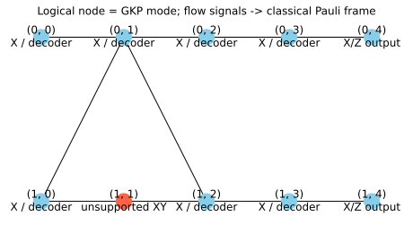

# Inspectable lowering

`lower_muta_to_gkp(model, parameters, config=config)` produces a
`PhysicalLoweringResult`. It holds the public `Pattern`, finite `GKPCode`,
input/output mode tuples, logical-node-to-mode map, measurement keys, frame
dependencies, decoder, configuration and capability/resource audit.

```python
from photographiqml import MuTA, GKPPhysicalConfig, lower_muta_to_gkp
model = MuTA(1)
config = GKPPhysicalConfig()
audit = model.physical_capabilities(config=config)  # No Fock projection.
assert audit["supported"]
lowered = lower_muta_to_gkp(model, config=config)  # Allocates finite codewords.
lowered.pattern.validate()
```

## Sequence and guards

The audit binds every parameter, including frozen values, and, for the default
`xy_protocol="signed-x"`, calls upstream `GKPCode.logical_measurement("XY", alpha=...)`
for every measured node (the XY family is audited differently; see below). It then
checks the decoder, supported backend and allocation estimates. Execution also
checks mode, shot count, seed, analog postselection and normalized product inputs
before constructing the finite codewords.

The schedule starts with input modes and prepares each future neighbor just
before the first incident measured vertex needs it. Every graph edge receives one
unit `GKPCode.logical_cz` command. Measurements remove modes and free the live
frontier. This reordering uses commutation of CZ edges and operations on other
vertices; it preserves the logical open graph. It is not a change in MuTA topology.

For cutoff K and m simultaneously live modes, the exclusive total-photon basis has
dimension `comb(K+m-1,m)`. The audit reports 16D bytes for a pure vector,
and an estimated 64Dout² workspace for joint
output readout. These are allocation estimates, not a measured peak-memory bound;
backend transforms and temporary arrays can require additional memory.
The audit also budgets the finite-code projection grid using the conservative
estimate `64 * grid_points * (cutoff + 2*peaks + 1)` bytes, so an excessive
integration grid cannot bypass the preallocation policy.

Each readout writes a structured record under `("raw", node)`. A public `Signal`
with explicitly declared dependencies writes its interpreted bit under
`("bit", node)`. Final outputs keep their physical state and virtual frame.
The lowering contains no analog displacement implementing a qubit Pauli correction.

`model.draw_physical(parameters, config=config)` runs only the audit and draws
unsupported measurement vertices red. Inspect it before expensive simulation.



## XY family (`xy_protocol`)

`GKPPhysicalConfig(xy_protocol=..., max_injection_rounds=4)` selects the measurement
instrument. The default `"signed-x"` reproduces the lowering above exactly. `"clifford"`,
`"auto"` and `"injection"` lower every measured node to `pg.GKPLogicalXYMeasurement` and
are used through `PhysicalMuTA(measurement_family="XY")`.

**Capability audit.** Each node is classified without calling the upstream factory and
without Fock allocation. An `angle_audit` row then carries `basis="XY"`, `protocol`,
`clifford` (angle is k pi/2 within 1e-12) and `ancilla_rounds_max`
(`max_injection_rounds` if the node may need a magic ancilla, else 0). A non-finite angle
is unsupported for every protocol; with `"clifford"` so is any angle other than k pi/2, and
`require_supported` raises `UnsupportedPhysicalMeasurement` naming the node before any
codeword is built. Because an injection round keeps one ancilla alive next to the measured
data mode, `peak_live_modes`, and with it `hilbert_dimension = comb(K+m-1, m)`, counts one
extra mode when any node needs an ancilla. Injected models therefore often need a larger
`max_dimension`. `required_operations` lists the logical-XY instrument, the
frame-adaptive angle, and, when used, the Gaussian shear and the magic ancilla / logical
CNOT / ancilla q homodyne.

```python
import numpy as np
from photographiqml import GKPPhysicalConfig, PhysicalMuTA, lower_muta_to_gkp
import photographiq as pg
config = GKPPhysicalConfig(cutoff=56, backend="native-fock", xy_protocol="auto",
                           max_dimension=200_000)
model = PhysicalMuTA(1, 1, one_column=True, measurement_family="XY", physical_config=config)
angles = dict(zip(model.parameters(), (0.0, 0.0, np.pi / 4, 0.0)))
audit = model.physical_capabilities(angles)
print(audit["peak_live_modes"], [r["ancilla_rounds_max"] for r in audit["angle_audit"]])
lowered = lower_muta_to_gkp(model, angles)
print([type(c.measurement).__name__ for c in lowered.pattern.commands
       if isinstance(c, pg.Measure)])
```

**Emitted instrument.** Each measured node becomes
`Measure(node, GKPLogicalXYMeasurement(angle, code, protocol=xy_protocol,
max_rounds=max_injection_rounds, decoder=NearestCellDecoder()), ("raw", node))`, followed
by the same interpreted-bit `Signal` as the signed-X lowering. The magic ancillas use the
same `GKPCode` as the data modes. Preparation, CZ scheduling and output handling are
unchanged.

**Frame-adaptive angles.** A node with no frame sources gets its numerical angle a. A node
whose frame depends on earlier interpreted bits gets a `CallableExpression` over those
`("bit", v)` records that evaluates to (-1)^x a, where x is the X component of the node's
frame. `simulate()` resolves it when the node is measured, so the physical instruction (for
example which magic state is prepared) depends on earlier outcomes. The Z component stays
the classical bit flip of the `Signal`; see [frames](pauli-frames.md).
See [frames](pauli-frames.md) for the correction convention and
[execution modes](execution-modes.md) for result semantics.
