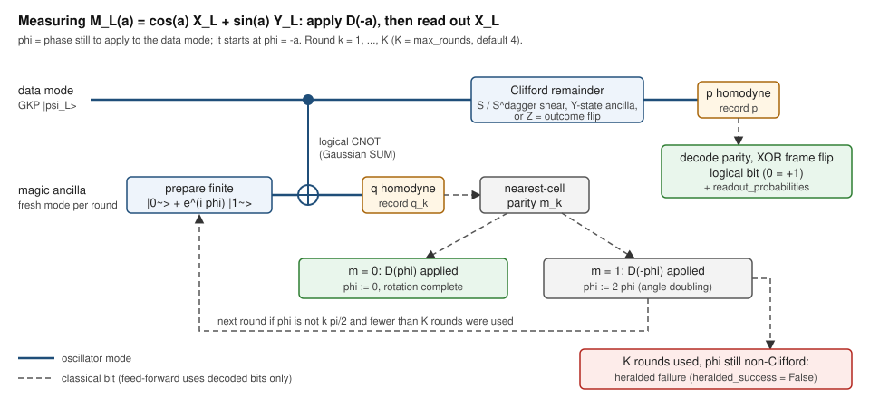

# Tutorial: physical arbitrary-angle XY measurement

This tutorial follows one logical measurement through the whole physical stack:

1. the **logical XY measurement** you ask for,
2. the **physical ancilla protocol** that realizes it on finite-energy GKP modes,
3. the **homodyne records** the protocol produces,
4. the **logical decoding** of those records,
5. the **corrected output** bit and its readout probabilities,

and then shows the same instrument inside a `PhysicalMuTA`. All code is taken from
`examples/ml/physical_xy_measurement.py` (run it from the repository root) and runs on the compiled `native-fock` engine. The resource is deliberately wide
(peak width and envelope 0.6) so the example finishes in about a minute; its decoded
numbers carry a large finite-energy error and are not converged.

Conventions: hbar = 2, interleaved (q, p) quadratures, total-photon Fock cutoff.

## 1. The logical measurement

The logical observable is M_L(a) = cos(a) X_L + sin(a) Y_L, with +1 eigenstate
(|0_L> + e^{ia}|1_L>)/sqrt(2). Outcome bit 0 means +1. On an ideal qubit:

```python
import numpy as np
import photographiq as pg

ANGLE = np.pi / 3
LOGICAL = (np.cos(0.4), np.exp(0.9j) * np.sin(0.4))  # a generic logical input state
ideal = pg.IdealLogicalXYMeasurement(ANGLE).probabilities(np.array(LOGICAL))
```

`IdealLogicalXYMeasurement` is a two-level reference only; it cannot be placed in a
pattern. The physical instrument has to produce the same statistics up to the
finite-energy error of the code.

Measuring M_L(a) equals applying D(-a) = diag(1, e^{-ia}) and then measuring X_L. GKP
already has a physical X_L readout (p homodyne and nearest-cell decoding), so the task is to
apply D(-a) physically. For a = k pi/2 this is a Clifford gate (Gaussian shear or a frame
flip); a = pi/3 is not Clifford and needs a magic-state ancilla.

## 2. The physical ancilla protocol

```python
CUTOFF = 56
code = pg.GKPCode(cutoff=CUTOFF, peak_width=0.6, envelope=0.6, peaks=6, grid_points=2049)
measurement = code.logical_measurement("XY", alpha=ANGLE, protocol="auto")  # max_rounds=4
pattern = pg.Pattern(inputs=("d",))
pattern.append(pg.Measure("d", measurement, "m"))
pattern.append(pg.Output(()))
options = {"backend": "native-fock", "cutoff": CUTOFF, "inputs": {"d": code.encode(*LOGICAL)}}
```

Without `protocol=`, `logical_measurement("XY", alpha=np.pi / 3)` still raises
`NotImplementedError`: the physical instrument is opt-in. `protocol="auto"` uses the
Gaussian route for Clifford angles and repeat-until-success injection otherwise. One
measurement runs the following rounds:



- **Round k.** A fresh mode is prepared in the finite-energy encoded state
  (|0~> + e^{i phi}|1~>)/norm, starting from phi = -a. The logical CNOT (a Gaussian SUM,
  data as control) entangles it with the data mode, and the ancilla q quadrature is
  measured.
- **Decoded bit.** Ideally m = 0 has applied D(phi) and the rotation is complete; m = 1 has
  applied D(-phi), so the next round targets 2 phi (angle doubling).
- **Stop.** The loop ends when the remaining phase is a multiple of pi/2. A remaining pi
  is a Z before the X readout, an exact outcome flip. A remaining +-pi/2 after injection
  rounds is injected with a Y-eigenstate ancilla; its failure leaves exactly Z, again a flip.
  After `max_rounds` non-Clifford rounds the record is a **heralded failure**.
- **Final readout.** The data p quadrature is measured and decoded; the frame flip is
  XORed onto the bit.

The encoded magic state is a supplied finite-Fock resource built from the same finite
codewords. Its preparation is not simulated.

## 3. Homodyne records

```python
record = pg.simulate(pattern, seed=1, **options).records["m"]
print("  rounds:                ", [(round(r["target_phase"], 4), round(r["raw_outcome"], 4), r["bit"]) for r in record.rounds])
print("  heralded_success:      ", record.heralded_success)
print("  applied_operations:    ", record.applied_operations)
print("  final p outcome, cell: ", round(record.raw_outcome, 4), record.cell)
```

Output of this seed (wide resource; see the note at the top):

```text
  rounds:                 [(-1.0472, 0.0594, 0)]
  heralded_success:       True
  applied_operations:     ('inject D(-1.0471975512); ancilla bit 0',)
  final p outcome, cell:  4.0031 2
```

`record.rounds` holds one dict per injection round: `target_phase` (the phi of that
round), `raw_outcome` (the ancilla q value), `bit`, `residual`, `cell` and `density` (the
homodyne point density). Here the first round succeeded. `record.joint_density` is the
product of all point densities, the likelihood density of the complete analog record; it
is not a probability.

A record can be fixed instead of sampled. The analog values are given as
`{"ancilla": [q_1, ...], "data": p}` and must contain exactly the rounds the protocol
takes for them:

```python
fixed = pg.simulate(
    pattern, seed=0, measurement_outcomes={"m": {"ancilla": [2.4, 0.1], "data": 0.3}}, **options
).records["m"]
print("  ancilla bits:          ", [r["bit"] for r in fixed.rounds])
```

q = 2.4 lies in an odd cell, so round 1 fails (bit 1), the angle doubles, and q = 0.1
ends round 2 with bit 0. With one ancilla value the instrument would need a second one
and raises `ValueError`; with three it raises as well.

## 4. Logical decoding

Every homodyne value is decoded by the same nearest-cell rule as the X/Z readouts: reduce
modulo the logical spacing sqrt(2 pi) and take the cell parity (`decode_shift`). The
ancilla bits drive the feed-forward (which magic state comes next); the analog residuals
never do. The final p value is decoded to the raw X_L parity.

## 5. Corrected output

```python
print("  bit (0 <-> +1):        ", record.bit)
print("  readout_probabilities: ", tuple(round(p, 4) for p in record.readout_probabilities))
```

`record.bit` is the logical outcome after the instrument's own frame flips
(`frame_correction` says whether one was applied). `readout_probabilities` are the exact
decoded X probabilities of the data state just before the final homodyne. Over many
trajectories their mean is a lower-variance (Rao-Blackwell) estimate of P(+1) than the
bit frequencies:

```python
shots = pg.run_shots(pattern, 8, seed=7, **options)
records = [t.records["m"] for t in shots.trajectories]
rao_blackwell = np.mean([r.readout_probabilities for r in records], axis=0)
print("  injection rounds used: ", [len(r.rounds) for r in records])
print("  all heralded success:  ", all(r.heralded_success for r in records))
```

Count `heralded_success` explicitly: with a budget of K rounds a generic angle fails with
ideal-code probability 2^-K, and a failed trajectory measured the wrong angle. The gap
between the Rao-Blackwell mean and the ideal value is the finite-energy error of this
wide resource plus sampling error; separating the two needs the convergence studies in
R61 and R62.

## 6. Inside PhotoGraphiQML

`PhysicalMuTA(measurement_family="XY")` lowers every measured vertex to this instrument.
Its angles become frame-adaptive: a node whose X frame bit is x measures (-1)^x a.

```python
from photographiqml import GKPPhysicalConfig, PhysicalMuTA, compare_logical_physical

config = GKPPhysicalConfig(
    cutoff=CUTOFF, peak_width=0.6, envelope=0.6, peaks=6, grid_points=2049,
    backend="native-fock", xy_protocol="auto", max_dimension=200_000,
)
model = PhysicalMuTA(1, 1, one_column=True, measurement_family="XY", physical_config=config)
angles = dict(zip(model.parameters(), (0.0, 0.0, np.pi / 4, 0.0)))
audit = model.physical_capabilities(angles, config=config)
print("  supported, peak modes, dimension:", audit["supported"], audit["peak_live_modes"], audit["hilbert_dimension"])
print("  ancilla rounds per node:        ", [row["ancilla_rounds_max"] for row in audit["angle_audit"]])
result = model.run([1, 0], angles, mode="physical-shots", shots=3, seed=2)
print("  rounds per node and shot:       ", [[len(r.rounds) for r in shot.values()] for shot in result.measurement_records])
```

```text
  supported, peak modes, dimension: True 3 30856
  ancilla rounds per node:         [0, 0, 4, 0]
```

The audit runs before any Fock allocation. Only the pi/4 node can need an ancilla
(up to 4 rounds); the magic ancilla is counted as one extra live mode, which is why
`max_dimension` is raised above its default. The default `PhysicalMuTA()` keeps the
signed-X family and is unaffected.

## Limitations

- Magic-state preparation is not simulated; the ancilla is a supplied resource.
- No rotated-homodyne substitution: a rotated quadrature does not measure M_L(a).
- Failed rounds add energy to the data mode, so injected nodes need a larger cutoff.
- Loss and detector-noise options exist on the standalone instrument and need a mixed
  Fock backend; the PhotoGraphiQML lowering does not expose them.
- Nothing here is a fault-tolerance, threshold or quantum-advantage claim.

## Further reading

- [GKP user guide](../../user-guide/gkp.md#physical-logical-y-and-xy-measurements): API, records, noise options.
- [Supported measurements](supported-measurements.md), [lowering](lowering.md),
  [execution modes](execution-modes.md), [Pauli frames](pauli-frames.md),
  [physical training](physical-training.md).
- [Implementation notes](../../development/GKP_ARBITRARY_ANGLE_IMPLEMENTATION.md) and
  [final report](../../development/GKP_ARBITRARY_ANGLE_FINAL_REPORT.md); experiments R60-R67
  in `paper_experiments_ml/14_gkp_xy/`.
