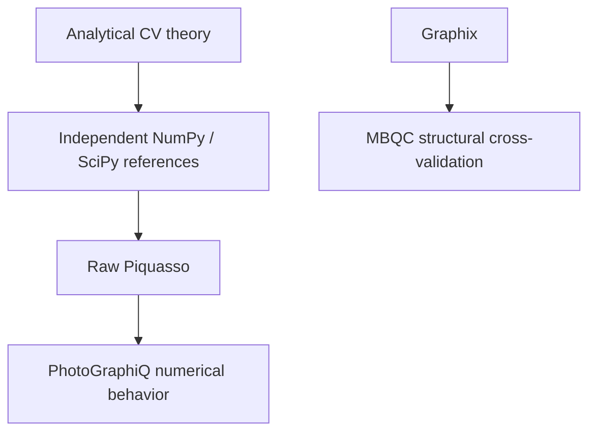

# Validation philosophy

Different comparisons answer different questions. Gaussian backends share a
measurement adapter, so agreement between them alone does not independently
validate detector statistics. Analytical moments and density integrals supply
that evidence. Graphix checks labels, edges, order and correction domains; it is
never a continuous-variable numerical oracle.

The [v0.2 hardening report](../release-hardening-report.md) records historical
Windows/Linux evidence. New mixed-state, synthesis, GKP and differentiation paths
have separate tests and remain experimental. A configured CI workflow is not a
passing run. Local checks and remote checks must be reported separately.

See the [feature matrix](feature-matrix.md), [numerical policy](numerical-policy.md),
and [detailed historical validation](../validation.md).

## 2026-11-12 audit (Phases 1–5)

- [Master validation status](MASTER_VALIDATION_STATUS.md): one row per requirement and the eight upgrade requests
- [Phase 1: release engineering and CI](PHASE1_RELEASE_AUDIT.md)
- [Phase 2: independent scientific validation](PHASE2_SCIENTIFIC_AUDIT.md)
- [Phase 3: feature completion](PHASE3_FEATURE_COMPLETION.md)
- [Phase 4: manuscript reproducibility](PHASE4_MANUSCRIPT_REPRODUCIBILITY.md)
- [Phase 5: final release audit](PHASE5_FINAL_RELEASE_AUDIT.md)

Evidence documents: [independent validation matrix](independent-validation-matrix.md), [native Fock Gaussian unitaries](native-fock-gaussian-unitary.md), [GBS threshold accuracy](gbs-threshold-accuracy.md), [CV-flow robustness](cv-flow-robustness.md), [interactive visualization in a browser](interactive-visualization-browser.md), [PhotoGraphiQML with MentPy](photographiqml-mentpy-validation.md).
