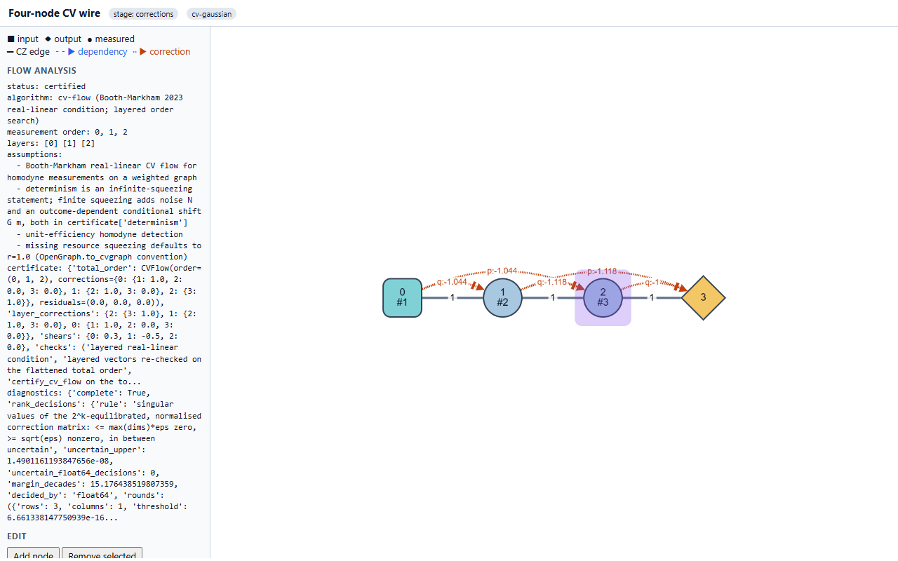
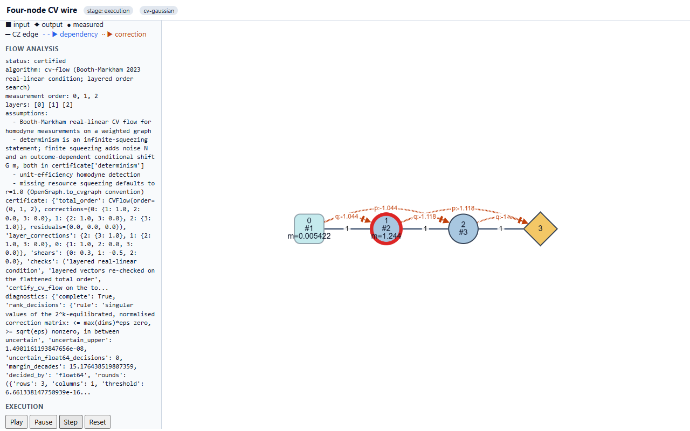
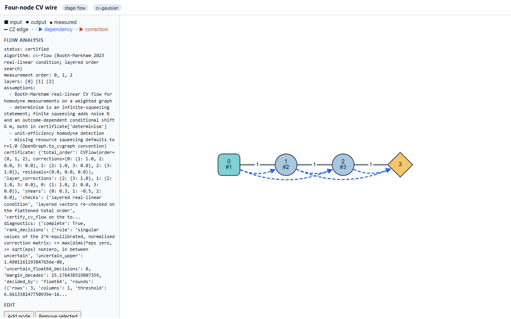
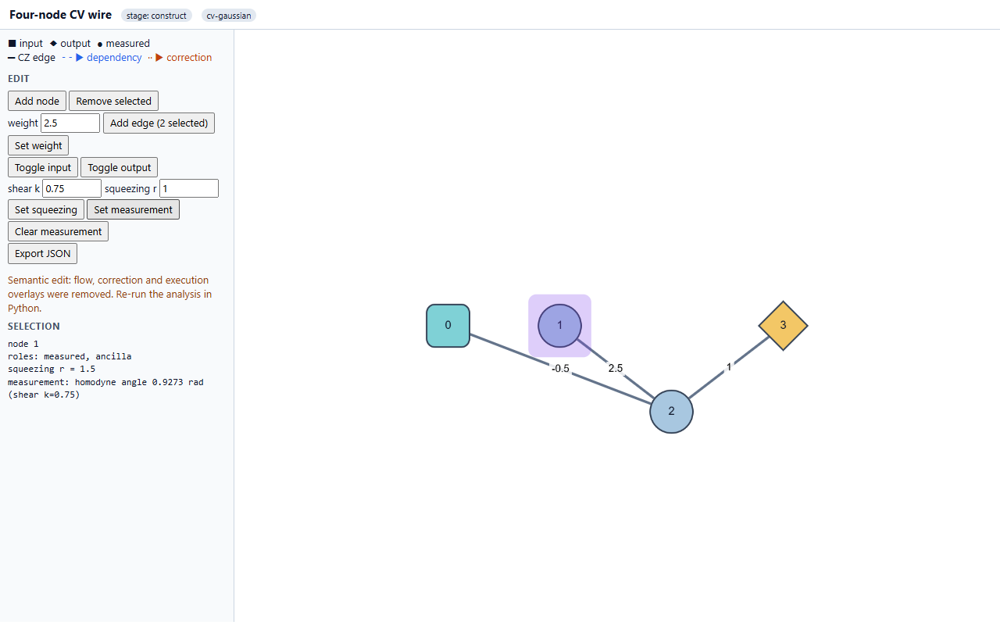
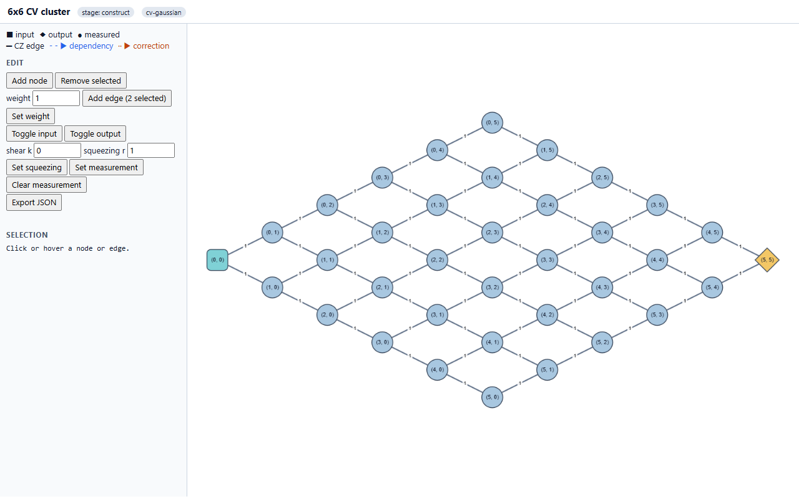
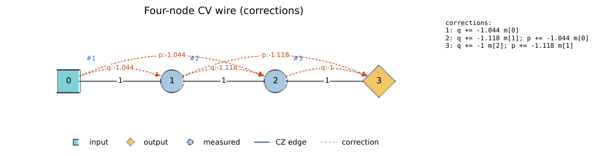

# Interactive visualization: real-browser validation

This page records a check of the `photographiq.interactive` HTML pages in a real browser.
The check uses real mouse, wheel and keyboard events and takes screenshots. Each drawn
element is compared with the Python model, the flow result, the `Pattern` commands and
an actual `simulate` trace. The existing `tests/visualization/test_interactive_browser.py`
only calls JavaScript functions through a harness. This check adds real input and visual
inspection.

## Environment

| Item | Value |
|---|---|
| OS | Windows 11 Home 10.0.26200 |
| Browser | Microsoft Edge 157.0.4341.46, headless, through Playwright `channel="msedge"` (no browser download) |
| Playwright | 1.65.1 (Python), in an isolated venv; the project `.venv` was not changed |
| Cytoscape.js | 3.30.2, inlined from a local copy through `PHOTOGRAPHIQ_CYTOSCAPE_JS` (the CDN was briefly unreachable during the session; the pinned CDN copy was verified to be the same 373 304-byte file) |
| Static rendering | Matplotlib (SVG/PDF/PNG); the SVG is rendered in Edge and the PDF with `pdftoppm` (poppler) |
| Viewport | 1280 x 800 CSS px, device scale 1; 2x crops for close inspection |

To reproduce:

```text
python scripts/check_interactive_browser.py OUT_DIR [--channel msedge|chrome]
```

The script writes the pages, `*.png` screenshots and `report.json` to `OUT_DIR`. It exits
with status 1 if any check fails. `tests/visualization/test_interactive_browser_playwright.py`
runs the same checks. It skips when Playwright cannot be imported, when no Edge or Chrome
is installed, or when Cytoscape.js cannot be loaded.

## Test cases

- **CV wire.** `CVGraph.line(4, squeezing=1.5, inputs=(0,), outputs=(3,))` with shears
  `{0: 0.3, 1: -0.5, 2: 0.0}`. Its flow comes from `flows.analyze` (certified CV flow,
  layers `[0] [1] [2]`). The pattern is `flow_pattern(...)`, and the trajectory is
  `simulate(..., backend="gaussian", seed=7)`.
- **Qubit graph.** Six nodes: edges 0-1, 1-2, 2-3, 3-4 and 1-5; input 0; outputs 4 and 5;
  XY measurements. It has a certified causal flow.
- **6 x 6 CV cluster.** `CVGraph.rectangular(6, 6)`: 36 nodes and 60 edges.

## Results

| # | Check | Result | Evidence (screenshots) |
|---|---|---|---|
| 1 | Node dragging | PASS | `01_drag_before.png`, `02_drag_after.png` |
| 2 | Panning and zooming | PASS | `03_pan.png`, `04_zoom_in.png` |
| 3 | Graph edits round trip | PASS (after fix F3) | `05_edits.png` |
| 4a | Construction stage | PASS | `06_stage_construct.png` |
| 4b | Flow stage, order and layers | PASS | `07_stage_flow.png` |
| 4c | Corrections stage and formulas | PASS (after fix F1) | `08_stage_corrections.png` |
| 5 | Execution animation | PASS (after fix F2) | `09_execution_mid.png`, `10_execution_end.png` |
| 6 | Layout scale | PASS (see limits) | `11_small_cv4.png`, `12_small_qubit6.png`, `13_qubit6_flow.png`, `14_grid6x6.png` |
| 7 | Static SVG/PDF/PNG exports | PASS (after fix F4) | `static_*_svg.png`, `static_corrections_pdf.png`, `static_qubit6_flow.png` |

### 1. Node dragging

- **Input.** A real mouse down, move (12 steps, +90/+120 px) and up on node 1.
- **Position.** The model position changed by exactly (90, 120)/zoom: (69.23, 92.31) at
  zoom 1.3. No other node moved.
- **Export.** Clicking **Export JSON** produced a real download. The downloaded file
  equals the text box.
- **Round trip.** `apply_edits` accepted the file. The new layout of node 1 is
  `(x/110, -y/110)` = (1.629, -0.839), and the other positions are unchanged.
  `graph.to_dict()` equals the original, so edges, weights, squeezing and measurements
  are unchanged.
- **Errors.** No page errors.

### 2. Panning and zooming

- **Pan.** Dragging on a background point (checked to lie outside every element's
  bounding box) moved `cy.pan()` by exactly (+150, +90). The zoom was unchanged, no node
  was selected, and every model position was identical.
- **Zoom.** One wheel notch over node 1 raised the zoom from 1.30 to 1.64. Node 1 stayed
  under the pointer (within 1 px), and the model positions were identical.
- **Export.** The export after pan and zoom gives the original layout and graph.

### 3. Graph edits

All edits were made with real clicks: a Shift-click for multiple selection, edge clicks
at the rendered midpoint, typing into the number inputs, and the panel buttons.

- **Edits made.**
  - Added the edge 0-2 with weight -0.5.
  - Set the weight of 1-2 to 2.5.
  - Removed edge 0-1.
  - Set node 1 to homodyne shear 0.75.
- **Export.** The exported download gives `{0-2: -0.5, 1-2: 2.5, 2-3: 1.0}` and shear 0.75.
  Squeezing and outputs are unchanged.
- **Validation.** `apply_edits` rebuilds a valid `OpenGraph`, and `flows.analyze` runs on
  it (it reports `not_certified`, as expected for the edited graph).
- **Invalid edit.** Setting a weight of 0 in the page and exporting is rejected by
  `apply_edits` with `Edge (2, 3) needs a finite nonzero weight`.
- **Overlay warning.** The page shows that semantic edits removed the flow, correction
  and execution overlays.
- **How the test selects edges.** On the straight wire, the new edge 0-2 is a straight
  line through node 1, on top of edge 1-2. A click on 1-2 then selects 0-2 (see limits).
  The check drags node 2 off the line first, and it asserts which edge each click
  selected.

### 4. Stages

- **Construction stage.** Only the three CZ edges are drawn (class `physical`; solid
  grey, `rgb(100,116,139)`, no arrowhead). No node carries an order or layer.
- **Flow stage.** The drawn dependency arrows equal `GraphView.flow_arrows()`, which is
  read from `flows.analyze(...).correction_map`. They are dashed blue (`rgb(37,99,235)`)
  with triangle heads, unlike the solid, arrowless CZ edges.
  - The node layer data equals `flow.layers`, and the panel shows `layers: [0] [1] [2]`.
  - Each node shows its `#k` measurement order.
- **Corrections stage.** The drawn arrows, with their labels, equal
  `pattern_corrections(pattern)`.
  - **Independent check.** The `(outcome key, node)` pairs are compared with the raw
    `Displace` commands of the `Pattern` that depend on outcomes. Both give `{(0,1),
    (0,2), (1,2), (1,3), (2,3)}`. The flow analysis gives the same pairs.
  - **Style.** The arrows are dotted orange (`rgb(194,65,12)`) with triangle-tee heads.
  - **Formulas.** `1: q += -1.044 m[0]`, `2: q += -1.118 m[1]; p += -1.044 m[0]` and
    `3: q += -1 m[2]; p += -1.118 m[1]` appear in the Notes panel. The Selection panel
    shows them on click, for example `correction: q += -1.118 m[1]; p += -1.044 m[0]`.
    They are readable.
  - **Arrow labels.** Readable after fix F1.

### 5. Execution animation

The **Step** button was clicked 15 times, once per trace step.

- **Step labels.** Each label equals `Step i/15: <trace.steps[i].label>`.
- **Outcomes.** At each measurement step, the `m=` value shown on the node equals the
  recorded value in `Result.outcomes` to the 4 significant figures displayed:

  | Node | Shown | Recorded |
  |---|---|---|
  | 0 | 0.005422 | 0.0054220463 |
  | 1 | 1.244 | 1.2441923698 |
  | 2 | -1.312 | -1.3121492010 |

- **Play.** **Reset** followed by **Play** runs to `Step 15/15` without page errors.
- **Highlighting.** The measured node is outlined red, and earlier nodes are faded.

### 6. Layout scale

| Graph | Default zoom font | Node/label box overlaps |
|---|---|---|
| CV wire, 4 nodes | 14.3 px | none |
| Qubit, 6 nodes (construction and flow) | 14.3 px | none |
| 6 x 6 cluster, 36 nodes | 8.8 px | none |

The 6 x 6 cluster uses the default `publication` layout, which places nodes by
breadth-first depth from the single input. The cluster is drawn as a diamond. All labels
such as `(2, 3)` and all weight labels can be read at the default zoom, but they are
small; zoom in for comfort.

### 7. Static exports

- **Files.** SVG for each of the four stages, a PDF of the corrections stage and a PNG
  of the qubit flow stage.
- **Rendering.** The SVG was rendered in Edge, the PDF with `pdftoppm`, and the PNG was
  viewed directly.
- **Readability.** Node labels, weight labels, `#k` order labels, `m=` outcomes,
  correction-arc labels, the legend and the monospace corrections block are all readable.
  SVG text stays as `<text>`.

## Defects found and fixed

All fixes are in `src/photographiq/interactive/`.

- **F1: correction-arc labels were crossed by other arcs** (`_template.py`,
  `graph_view.py`).
  - **Problem.** Cytoscape draws each edge's label with the edge itself. Longer correction
    arcs, drawn later, ran through the labels of shorter arcs. In the CV wire, `q:-1.044`,
    `q:-1.118` and `q:-1` were struck through, and the label backgrounds were only 80%
    opaque.
  - **Fix.** Each overlay arrow now carries an integer `z`, and shorter arcs are drawn on
    top (`"z-index": "data(z)"`). Correction labels have an opaque background with 1 px
    padding.
  - **Check.** The script asserts that shorter arcs have a higher z-index.
- **F2: recorded outcomes were drawn at 50% opacity** (`_template.py`).
  - **Problem.** `node.done` used `opacity: 0.5`, which also fades the label. In the
    execution stage, the `m=` outcomes of already-measured nodes were the faintest text
    on the page.
  - **Fix.** The style now fades only the background and border, so the text stays
    opaque.
  - **Check.** Asserted at every measurement step.
- **F3: the Selection panel went stale after an edit** (`_template.py`).
  - **Problem.** After **Set measurement**, **Set weight** and similar edits, the panel
    still showed the old values, for example `shear k=-0.5` after setting 0.75.
  - **Fix.** The page now refreshes the panel when a selected element's data changes
    (`cy.on("data", ...)`).
  - **Check.** Asserted in check 3.
- **F4: SVG fonts had no generic fallback** (`static.py`).
  - **Problem.** Static SVGs declared only `font-family: 'DejaVu Sans'`. On systems
    without that font, such as Windows with Edge, every label fell back to Times.
  - **Fix.** The style now uses `font.family = "sans-serif"` with
    `font.sans-serif = ["DejaVu Sans", "Arial", "Helvetica"]`. The SVG then declares
    `'DejaVu Sans', 'Arial', 'Helvetica', sans-serif`. PNG and PDF output is unchanged,
    because Matplotlib still uses the bundled DejaVu Sans.
  - **Check.** Asserted in check 7.

Screenshots after the fixes:








## Remaining limits

- **Arcs and edges can pass through other nodes.** Edges are straight, and arcs use a
  fixed bend of 0.22 x their length.
  - On the qubit graph, the dependency 0 -> 2 runs under node 1. It reads like
    0 -> 1 followed by 1 -> 2, and the same happens for 2 -> 4 through node 3. This
    shows in both `13_qubit6_flow.png` and the static PNG. Hovering an arrow shows its
    true dependency.
  - An edge added between collinear nodes is hidden under the nodes between them.
  - Fixing this needs layout-aware edge routing, which was not attempted.
- **Outcome labels overflow nodes.** A three-line label such as `0 / #1 / m=0.005422`
  is wider than the 42 px node. It extends past the node border, but it stays readable
  and does not reach other labels.
- **Execution controls can sit below the fold.** The flow panel prints the certificate
  and diagnostics in full, truncated at 400 characters each. At 1280 x 800, this pushes
  the execution controls and step list below the fold of the side panel, which scrolls.
- **Small labels on large graphs.** On the 6 x 6 cluster at default zoom, labels are
  8.8 px. The check only requires at least 8 px. Larger graphs will need zooming.
- **Static `#k` order labels.** In static figures, these labels sit up and to the right
  of each node, and on the CV wire they touch the correction arcs. They remain readable.
- **Not covered.** Touch input, Firefox/WebKit and high-DPI rendering were not tested.
  The Plotly plot pages are covered only by the existing harness test, not by this
  script.
- **Overlays are not recomputed.** The page does not re-run any analysis after an edit.
  It removes the overlays and asks you to re-run the analysis in Python, as designed.
